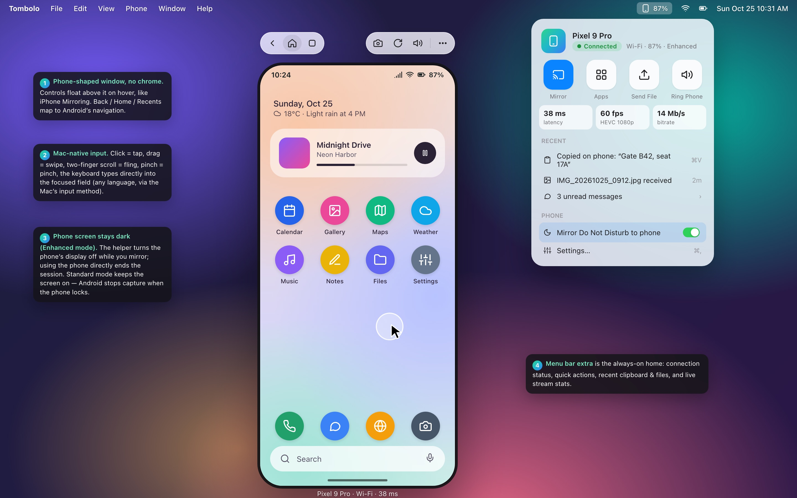
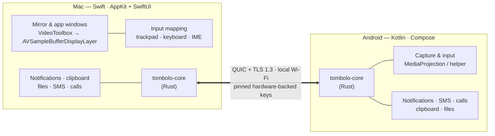
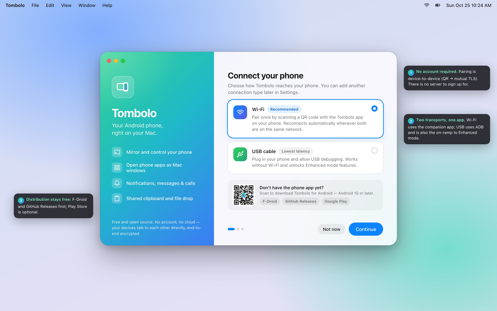
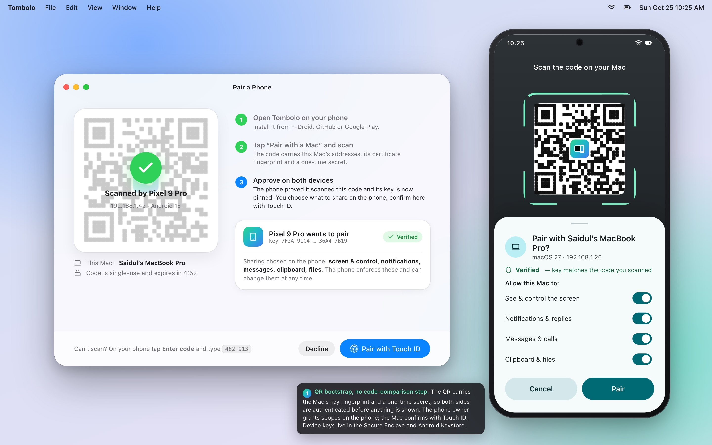
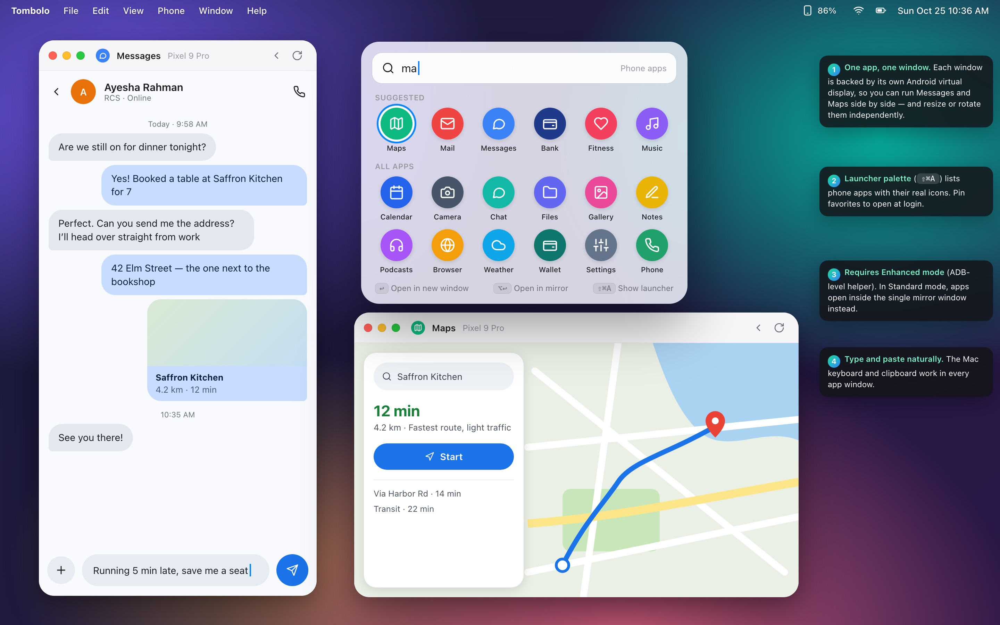
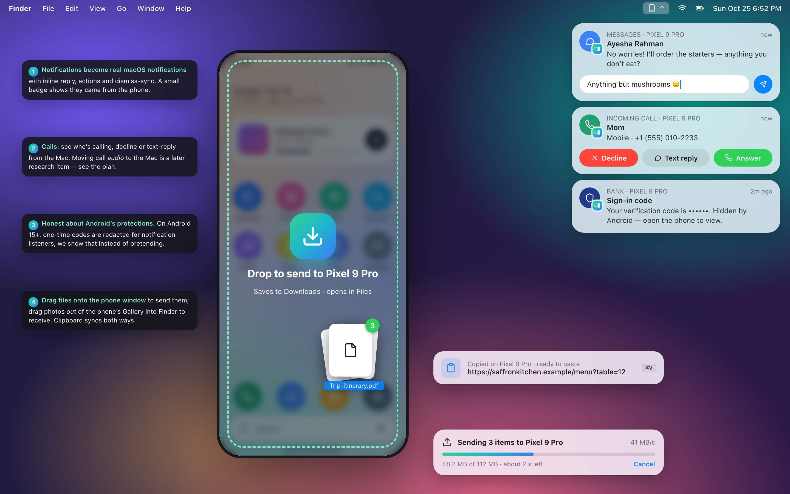
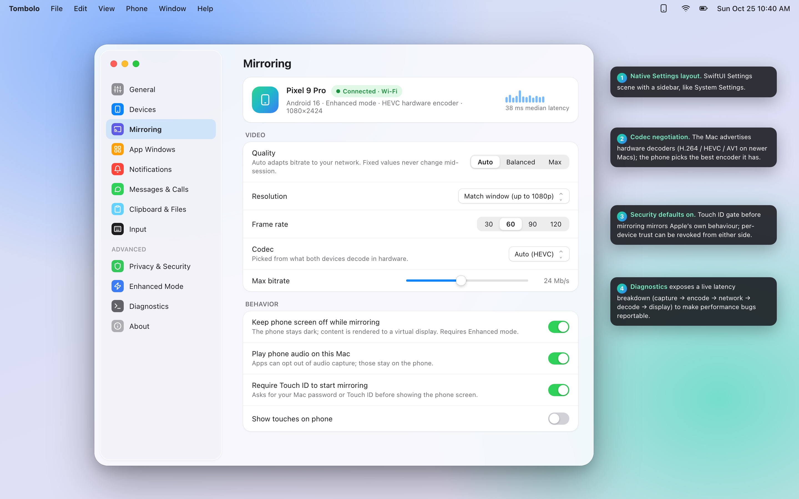
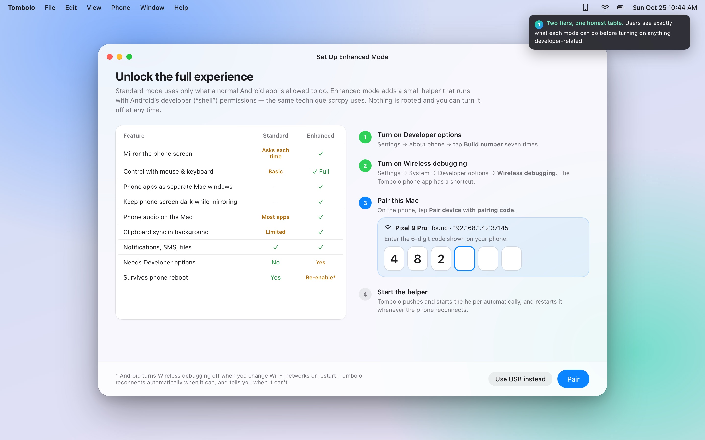
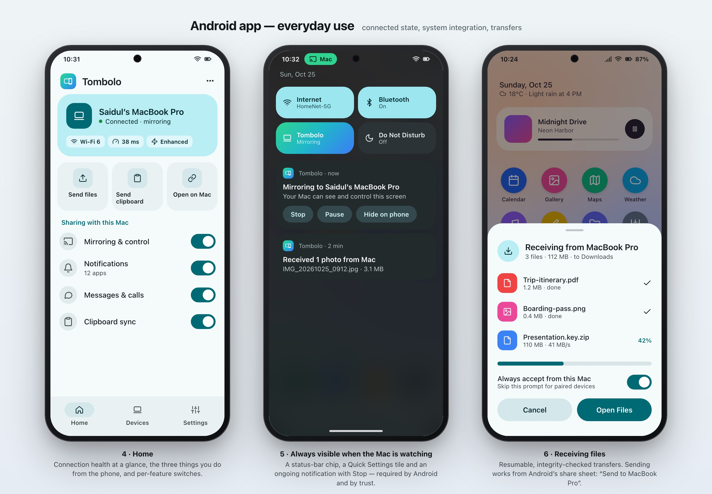

# Tombolo

**Your Android phone, on your Mac.**

A free and open-source, native macOS app plus Android companion that brings an
*iPhone Mirroring*-style experience to Android: mirror and control your phone, open phone apps as
Mac windows, and get notifications, messages, calls, clipboard and files on your Mac — with no account,
no cloud and no subscription.

*A **tombolo** is a sandbar that joins an island to the mainland.*

> 🚧 **Status: Phase 0 — spikes & security design.** No application code yet. The plan below was re-ordered on
> 2026-11-02 so the first release needs no developer options — feedback welcome in
> [Issues](https://github.com/SaidulBadhon/tombolo/issues).

## Why

Apple's iPhone Mirroring shows how good phone ↔ computer integration can feel. Android users on a Mac have
nothing equivalent that is **free, open-source and native**:

- **scrcpy** is a superb mirroring engine, but it's a command-line tool with an SDL window and no phone-side
  features (notifications, SMS, calls).
- **KDE Connect** has the continuity features and now an official macOS build, but it's Qt-based and has no
  mirroring.
- **AirSync** and **LinkMyMac** come close, but they're not open-source and put mirroring behind a paywall.
- **Phone Link**, **Phone Hub** and OEM apps are Windows-only, ChromeOS-only, or for one phone brand.

Tombolo aims to fill that gap: one native Mac app and one Android app, for any Android brand, licensed so it
stays free forever. Full survey: [`docs/research/01-existing-solutions.md`](docs/research/01-existing-solutions.md).

## What it will do

| | Feature | Mode |
|---|---|---|
| 🪞 | Mirror your phone in a phone-shaped Mac window, with audio | Standard / Enhanced |
| 🖱️ | Control it with trackpad, mouse and keyboard (any input language) | Standard (typing: Android 13+) / Enhanced |
| 🪟 | Open individual phone apps as separate, resizable Mac windows | Enhanced |
| 🔔 | Phone notifications as native Mac notifications, with inline reply | Standard |
| 💬 | SMS conversations, caller ID, decline/answer calls from the Mac | Standard |
| 📋 | Shared clipboard | Standard (phone→Mac manual) / Enhanced (both ways, automatic) |
| 📁 | Drag-and-drop files both ways, share-sheet "Send to Mac" | Standard |
| 🔒 | Encrypted, device-to-device pairing by QR code; the phone decides what the Mac may access; Touch ID before control | — |

**Standard mode** needs only the two apps — no developer options — and is what the first release ships.
**Enhanced mode**, the optional *Advanced* setting from 0.3, adds a small helper using Android's developer
("shell") permissions — the technique scrcpy uses — for per-app windows, a dark-screen mirror and
full-fidelity input. It is set up from the phone app through Wireless debugging. No root, ever. Details:
[`docs/architecture.md`](docs/architecture.md#2-two-capability-tiers-one-protocol).

## How it works

- **Video:** hardware H.264/HEVC on the phone (MediaProjection in Standard mode) → VideoToolbox decode and
  `AVSampleBufferDisplayLayer` presentation on the Mac — ~24 ms faster than Metal on `CAMetalDisplayLink` on the
  tested macOS 27 setup ([spike S2](docs/spikes/s02-mac-video.md)). Standard-mode target on 5 GHz Wi-Fi:
  p50 ≤ 100 ms, p95 ≤ 180 ms glass to glass (optical measurement still to come). Wi-Fi only at first; a USB link
  without developer options is a spike (S18) before 1.0.
- **Transport:** QUIC streams per window plus datagrams for audio, from one shared Rust core
  ([ADR-0003](docs/decisions/0003-transport.md)).
- **Security:** QR bootstrap with a one-time secret, P-256 keys in the Secure Enclave and Android Keystore,
  phone-authoritative permissions, sessions that fail closed, no trust-on-first-use, no plaintext mode — and
  pairing is built behind a flag, with nothing that contains it shipped until the external review of its design
  closes ([ADR-0005](docs/decisions/0005-pairing-and-identity.md)).

## Design concepts

| | |
|---|---|
|  |  |
|  |  |
|  |  |

All screens and the design principles: [`docs/design/ui-concepts.md`](docs/design/ui-concepts.md).

## Roadmap

| Release | Theme | Highlights |
|---|---|---|
| **0.1** | Mirror | Install two apps, no developer options: QR pairing, mirroring with audio and control over Wi-Fi (typing on Android 13+), Mac → phone paste |
| **0.2** | Connect | Notifications, SMS, caller ID, clipboard both ways, files, background reconnection |
| **0.3** | Advanced (optional) | Per-app windows, dark-screen mirroring, no per-session prompt — via Wireless debugging, set up on the phone |
| **1.0** | Polish | Per-app Dock icons, Touch ID gate, auto-updates, external review of the implementation, localisation |
| 1.x | Beyond | Webcam, remote access via self-hosted relay, USB without developer options, interop with LocalSend/KDE Connect |

Estimated effort to 1.0: **≈ 85–126 engineer-weeks**. The first usable release (0.1) is **≈ 46–67
engineer-weeks from project start** (Phase 0 + Phase 1; Phase 0 is partly done) — very roughly 6–9 months with two
developers — plus however long the external security review takes. Re-planned on 2026-11-02
([why](docs/plans/standard-first.md)) after two rounds of independent review; Phase 0 (spikes + security design)
is under way, and its exit gate re-estimates everything after it.
Full roadmap with feasibility ratings: [`docs/roadmap.md`](docs/roadmap.md) ·
Phase-by-phase plan: [`docs/implementation-plan.md`](docs/implementation-plan.md) —
[Phase 1](docs/implementation-plan.md#phase-1--mirror-no-developer-options-3450-ew--release-01) (0.1) ·
[Phase 2](docs/implementation-plan.md#phase-2--connect-1420-ew--release-02) (0.2) ·
[Phase 3](docs/implementation-plan.md#phase-3--advanced-mode-optional-1727-ew--release-03) (0.3) ·
[Phase 4](docs/implementation-plan.md#phase-4--10-812-ew) (1.0).

## Requirements (planned)

- **Mac:** macOS 14 Sonoma or later, Apple silicon.
- **Phone:** Android 10 or later. Any brand. Typing from the Mac needs Android 13+ (Android 10–12: view and
  gestures); the optional Advanced mode needs Android 11+ and Developer options.
- **Connection:** same Wi-Fi network (or the phone's hotspot). USB without developer options is not in the first
  releases.

## Documentation

| Document | What's inside |
|---|---|
| [Research summary](docs/research/README.md) | The ten findings that shape the plan; what's possible vs. hard vs. out of reach |
| [Architecture](docs/architecture.md) | Components, capability tiers, video/input paths, security model, tech stack |
| [Protocol draft](docs/protocol.md) | Channels, messages, media framing, pairing, versioning |
| [Implementation plan](docs/implementation-plan.md) | Phases, spikes and decision gates, acceptance criteria, risks, testing |
| [Re-plan: Standard mode first](docs/plans/standard-first.md) | Why the first release needs no developer options (approved 2026-11-02) |
| [Phase 0 task plan](docs/plans/phase-0.md) | The Phase 0 tasks with file ownership, dependencies and acceptance criteria |
| [Roadmap](docs/roadmap.md) | Features by release, with feasibility ratings |
| [Decisions (ADRs)](docs/decisions/README.md) | Why each major technical choice was made |
| [UI concepts](docs/design/ui-concepts.md) | Mockups for macOS and Android, interaction model |

## Principles

1. **Free core, forever.** No account, no cloud, no subscription for anything core.
2. **Native on both sides.** Swift/AppKit/SwiftUI on the Mac, Kotlin/Compose on Android.
3. **Honest capability tiers.** Users see exactly what each mode can and can't do.
4. **Private by default.** Device-to-device encryption, visible indicators whenever the Mac is watching,
   sensitive content excluded by default.
5. **Measure, don't guess.** Latency, CPU and battery numbers are published with every release.

## Contributing

The project is in the planning stage. The most useful contributions right now are reviews of the
[architecture](docs/architecture.md) and [implementation plan](docs/implementation-plan.md) — open an issue
with questions, corrections or device-specific knowledge.

## Licence

Tombolo is free software under the **[GNU GPL v3.0 or later](LICENSE)** — every fork stays free and open.
The [protocol specification](docs/protocol.md) (and the `proto/` schemas, once they exist) is licensed under
**[Apache-2.0](LICENSES/Apache-2.0.txt)**, so anyone can build compatible software. See
[ADR-0007](docs/decisions/0007-license.md).

## Acknowledgements

Tombolo stands on the shoulders of [scrcpy](https://github.com/Genymobile/scrcpy) (Apache-2.0),
[KDE Connect](https://kdeconnect.kde.org/), [Shizuku](https://github.com/RikkaApps/Shizuku),
[iroh](https://github.com/n0-computer/iroh), [LocalSend](https://localsend.org/) and
[droidMirroring-mac](https://github.com/matyle/droidMirroring-mac). Android is a trademark of Google LLC; Mac,
macOS and iPhone are trademarks of Apple Inc. Tombolo is not affiliated with either.
