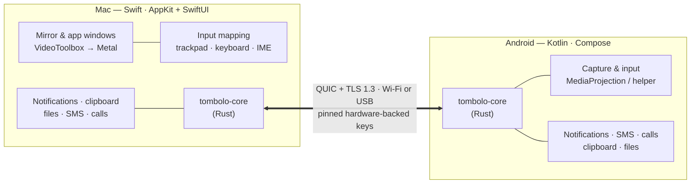

# Tombolo

**Your Android phone, on your Mac.**

A free and open-source, native macOS app plus Android companion that brings an
*iPhone Mirroring*-style experience to Android: mirror and control your phone, open phone apps as
Mac windows, and get notifications, messages, calls, clipboard and files on your Mac — with no account,
no cloud and no subscription.

*A **tombolo** is a sandbar that joins an island to the mainland.*

> 🚧 **Status: research & planning.** No application code yet. The plan below is up for review —
> feedback welcome in [Issues](https://github.com/SaidulBadhon/tombolo/issues).

## Why

Apple's iPhone Mirroring shows how good phone ↔ computer integration can feel. Android users on a Mac have
nothing equivalent that is **free, open-source and native**:

- **scrcpy** is a superb mirroring engine, but it's a command-line tool with an SDL window and no phone-side
  features (notifications, SMS, calls).
- **KDE Connect** has the continuity features and now an official macOS build, but it's Qt-based and has no
  mirroring.
- **AirSync** and **LinkMyMac** come close, but they're not open-source and put mirroring behind a paywall.
- **Phone Link**, **Phone Hub** and OEM apps are Windows-only, ChromeOS-only, or for one phone brand.

Tombolo aims to fill that gap: one native Mac app and one Android app, for any Android brand, licensed so it
stays free forever. Full survey: [`docs/research/01-existing-solutions.md`](docs/research/01-existing-solutions.md).

## What it will do

| | Feature | Mode |
|---|---|---|
| 🪞 | Mirror your phone in a phone-shaped Mac window, with audio | Standard / Enhanced |
| 🖱️ | Control it with trackpad, mouse and keyboard (any input language) | Standard / Enhanced |
| 🪟 | Open individual phone apps as separate, resizable Mac windows | Enhanced |
| 🔔 | Phone notifications as native Mac notifications, with inline reply | Standard |
| 💬 | SMS conversations, caller ID, decline/answer calls from the Mac | Standard |
| 📋 | Shared clipboard | Standard (Mac→phone) / Enhanced (both ways, automatic) |
| 📁 | Drag-and-drop files both ways, share-sheet "Send to Mac" | Standard |
| 🔒 | Encrypted, device-to-device pairing by QR code; the phone decides what the Mac may access; Touch ID before control | — |

**Standard mode** needs only the app. **Enhanced mode** adds a small helper using Android's developer
("shell") permissions — the technique scrcpy uses — for per-app windows, a dark-screen mirror and
full-fidelity input. No root, ever. Details: [`docs/architecture.md`](docs/architecture.md#2-two-capability-tiers-one-protocol).

## How it works

- **Video:** hardware H.264/HEVC on the phone → hardware decode and Metal presentation on the Mac. Target
  latency ≈ 30–60 ms on USB, ≈ 40–80 ms on Wi-Fi (to be measured in Phase 0).
- **Transport:** QUIC streams per window plus datagrams for audio, from one shared Rust core
  ([ADR-0003](docs/decisions/0003-transport.md)).
- **Security:** QR bootstrap with a one-time secret, P-256 keys in the Secure Enclave and Android Keystore,
  phone-authoritative permissions, sessions that fail closed, no trust-on-first-use, no plaintext mode — and the
  pairing design is externally reviewed before it is implemented
  ([ADR-0005](docs/decisions/0005-pairing-and-identity.md)).

## Design concepts

| | |
|---|---|
|  |  |
|  |  |
|  |  |

All screens and the design principles: [`docs/design/ui-concepts.md`](docs/design/ui-concepts.md).

## Roadmap

| Release | Theme | Highlights |
|---|---|---|
| **0.1** | Mirror | Native mirroring, control, audio, clipboard over USB/Wireless debugging (developer preview) |
| 0.1.x | App windows | Phone apps as separate Mac windows (experimental) |
| **0.2** | Connect | Android app, QR pairing, notifications, SMS, caller ID, clipboard, files |
| **0.3** | Standard mode | Mirroring and control without developer options |
| **1.0** | Polish | Per-app Dock icons, Touch ID gate, auto-updates, F-Droid, security review |
| 1.x | Beyond | Webcam, remote access via self-hosted relay, interop with LocalSend/KDE Connect |

Estimated effort to 1.0: **≈ 72–103 engineer-weeks** — about 11–14 months with two developers, 18–26 solo —
after two rounds of independent review. Approval is requested for **Phase 0 only** (spikes + security design),
which re-estimates everything after it.
Full roadmap with feasibility ratings: [`docs/roadmap.md`](docs/roadmap.md) ·
Phase-by-phase plan: [`docs/implementation-plan.md`](docs/implementation-plan.md).

## Requirements (planned)

- **Mac:** macOS 14 Sonoma or later, Apple silicon.
- **Phone:** Android 10 or later (Enhanced-mode audio needs Android 11+). Any brand.
- **Connection:** same Wi-Fi network, or a USB cable.

## Documentation

| Document | What's inside |
|---|---|
| [Research summary](docs/research/README.md) | The ten findings that shape the plan; what's possible vs. hard vs. out of reach |
| [Architecture](docs/architecture.md) | Components, capability tiers, video/input paths, security model, tech stack |
| [Protocol draft](docs/protocol.md) | Channels, messages, media framing, pairing, versioning |
| [Implementation plan](docs/implementation-plan.md) | Phases, spikes and decision gates, acceptance criteria, risks, testing |
| [Roadmap](docs/roadmap.md) | Features by release, with feasibility ratings |
| [Decisions (ADRs)](docs/decisions/README.md) | Why each major technical choice was made |
| [UI concepts](docs/design/ui-concepts.md) | Mockups for macOS and Android, interaction model |

## Principles

1. **Free core, forever.** No account, no cloud, no subscription for anything core.
2. **Native on both sides.** Swift/AppKit/SwiftUI on the Mac, Kotlin/Compose on Android.
3. **Honest capability tiers.** Users see exactly what each mode can and can't do.
4. **Private by default.** Device-to-device encryption, visible indicators whenever the Mac is watching,
   sensitive content excluded by default.
5. **Measure, don't guess.** Latency, CPU and battery numbers are published with every release.

## Contributing

The project is in the planning stage. The most useful contributions right now are reviews of the
[architecture](docs/architecture.md) and [implementation plan](docs/implementation-plan.md) — open an issue
with questions, corrections or device-specific knowledge.

## Licence

**To be decided** before the first line of code — see [ADR-0007](docs/decisions/0007-license.md)
(recommended: GPL-3.0-or-later for the apps, with the protocol specification under a permissive licence).

## Acknowledgements

Tombolo stands on the shoulders of [scrcpy](https://github.com/Genymobile/scrcpy) (Apache-2.0),
[KDE Connect](https://kdeconnect.kde.org/), [Shizuku](https://github.com/RikkaApps/Shizuku),
[iroh](https://github.com/n0-computer/iroh), [LocalSend](https://localsend.org/) and
[droidMirroring-mac](https://github.com/matyle/droidMirroring-mac). Android is a trademark of Google LLC; Mac,
macOS and iPhone are trademarks of Apple Inc. Tombolo is not affiliated with either.
