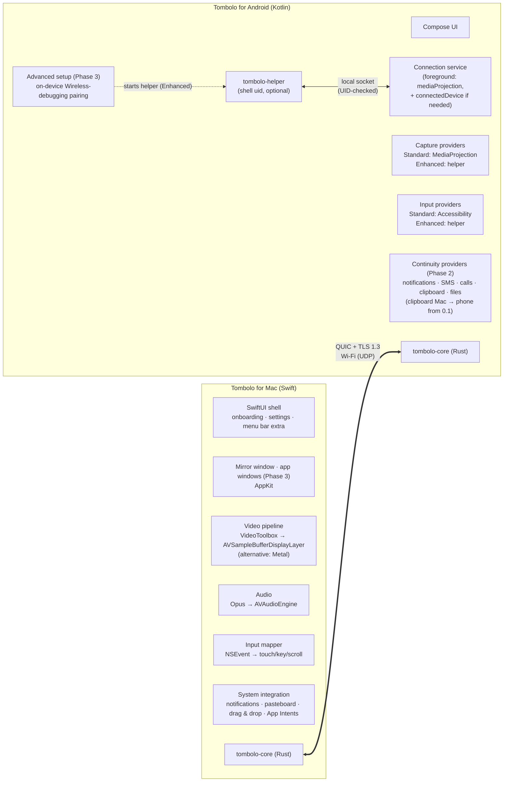

# Architecture

> Status: **proposed** — for review before any implementation starts.
> Evidence for every claim here is in [`research/`](research/); key decisions are recorded as ADRs in
> [`decisions/`](decisions/).
>
> Updated 2026-11-02 for the approved [Standard-first re-plan](plans/standard-first.md)
> ([ADR-0008](decisions/0008-standard-mode-first.md)): the first release needs no Developer options. Phases:
> 1 = 0.1 Mirror, 2 = 0.2 Connect, 3 = 0.3 Advanced, 4 = 1.0.

## 1. System overview

Tombolo is two native apps that speak one protocol:

- **Tombolo for Mac** — Swift 6 (AppKit for the video/input hot path, SwiftUI for everything else),
  macOS 14+, Apple silicon.
- **Tombolo for Android** — Kotlin + Jetpack Compose (Material 3), Android 10+ (API 29), targeting the
  latest API level.
- **tombolo-core** — a shared Rust library (transport, pairing, protocol framing, file transfer), exposed
  to Swift and Kotlin through UniFFI, so the security-critical code exists exactly once.
- **tombolo-helper** — an optional, shell-privileged helper process on the phone (a fork of the
  Apache-2.0 `scrcpy-server`) that unlocks *Enhanced mode* — the optional **Advanced** setting, from Phase 3
  (0.3), set up from the phone app through Wireless debugging.

The first release (0.1 Mirror) is Standard mode only: the user installs the two apps, pairs them with a QR code
on the local network and mirrors over Wi-Fi — no Developer options, no `adb`. The Advanced setup, the helper and
their links in the diagram are Advanced-only (Phase 3): the phone app sets the helper up itself, and nothing on the
Mac starts a helper before Phase 3 ([§4.2](#42-how-enhanced-mode-is-started)).



## 2. Two capability tiers, one protocol

The central design decision ([ADR-0001](decisions/0001-two-tier-capability-model.md)). Android only lets a
normal app do part of what an iPhone-Mirroring-class experience needs. Rather than pick one side, Tombolo
ships both, behind the same protocol. Standard mode is the default **and ships first** (0.1 and 0.2 contain only
Standard mode); Enhanced mode is the optional *Advanced* setting from 0.3
([ADR-0008](decisions/0008-standard-mode-first.md)):

| | **Standard mode** (default, from 0.1) | **Enhanced mode** (opt-in *Advanced* setting, from 0.3) |
|---|---|---|
| Who provides capture/input | The Tombolo app itself | `tombolo-helper`, running with the `shell` user's permissions |
| Setup | Install the app, pair once; grant Accessibility for control | Also turn on Developer options + Wireless debugging; the phone app pairs with Wireless debugging **on the phone** and starts the helper itself ([§4.2](#42-how-enhanced-mode-is-started)) |
| Screen capture | MediaProjection — Android asks **every session**; stops when the phone locks (Android 15 QPR1+), and unlocking needs a fresh consent | No per-session prompt; the phone's panel can be turned **off** while mirroring an awake, **unlocked** phone (neither mode mirrors a locked phone) |
| Control | AccessibilityService gestures (planned strokes); text via the accessibility input method on **Android 13+ only** (Android 10–12: gestures, no text input). View-only where a device or configuration blocks Accessibility (spike S6) | Real-time multi-touch, key events, virtual HID keyboard/mouse |
| Phone apps as Mac windows | — (single mirror window) | One Android virtual display per Mac window |
| Audio | Playback capture tied to the projection consent (media/game audio from apps that allow it; never call audio) | Playback capture without prompts (Android 11+) |
| Clipboard phone → Mac | Manual (tile/share/button) | Automatic |
| After a reboot | Keeps working | Helper must be restarted (by the phone app, through Wireless debugging) |
| Who can drive the phone | Only a paired Mac, within the scopes the phone granted | Also **any ADB-authorised controller** while Wireless debugging is on, whatever Tombolo's scopes say ([§8](#8-security-model)) |
| Continuity features (notifications, SMS, calls, files) | ✅ | ✅ (same code — they never need the helper) |

The Mac never needs to know *how* a capability is implemented: the phone announces its **server mode** and a
**capability list** in the `Hello` message, and the Mac adapts the UI (for example, the app launcher opens
apps in new windows only when the `display.virtual` capability is present).

## 3. Mac app

### 3.1 Modules (Swift packages inside one Xcode project)

Packages without a phase label are built in Phase 1 (0.1).

| Package | Responsibility | Key APIs |
|---|---|---|
| `TomboloApp` | App lifecycle, scenes, menu bar extra, onboarding, settings, device list | SwiftUI, `MenuBarExtra`, `SMAppService`, Observation |
| `MirrorKit` | Mirror window; per-app windows from Phase 3 (Enhanced); window ↔ display mapping; hover toolbar | AppKit `NSWindow`/`NSView`, layer hosting for the presenter |
| `VideoPipeline` | Annex-B parsing → `CMSampleBuffer` → VideoToolbox decode → presentation, latest-frame-wins. **Default presenter `AVSampleBufferDisplayLayer`**; alternative Metal presenter behind the renderer toggle ([§3.2](#32-video-path-per-window)) | VideoToolbox, `AVSampleBufferDisplayLayer`, Metal, `CAMetalDisplayLink` (14+) |
| `AudioPipeline` | Opus decode, small adaptive jitter buffer, playback | libopus (BSD), `AVAudioEngine` |
| `InputKit` | NSEvent → Android events: click/drag → touch, scroll phases → scroll/fling, magnify/rotate → two-finger gestures, keyboard → text commits (`NSTextInputClient` for IME/non-Latin input) or, in Enhanced mode, key events, shortcut map | AppKit events |
| `ContinuityKit` *(Phase 2; manual clipboard Mac → phone from Phase 1)* | Mirrored notifications with reply/actions, clipboard bridge, drag-and-drop file send/receive (file promises), SMS/calls UI models | `UserNotifications`, `NSPasteboard`, `NSItemProvider` |
| `ADBKit` *(Phase 3, Advanced only)* | ADB integration for Enhanced mode — **nothing in 0.1 or 0.2 uses `adb`**. Drives a bundled `adb` (built from AOSP sources, Apache-2.0 + NOTICE) or the user's existing install — device tracking, Wireless-debugging pairing, push, shell, loopback-only forwards; coexists with an Android Studio `adb` server on `:5037`. Used by `ScrcpyBridge` and the Mac-side way to start the helper ([§4.2](#42-how-enhanced-mode-is-started)). A native Swift/Rust ADB client is a post-1.0 item | `Process`, Network.framework |
| `ScrcpyBridge` *(Phase 3, Advanced only)* | Client for a **pinned** `scrcpy-server` build, for the Advanced phase's bring-up and spikes (S3 virtual displays, S9 UHID keyboard, S14 app compatibility) before `tombolo-helper` relays media through the Tombolo session; retired in Phase 3 | — |
| `CoreBindings` | Generated Swift bindings for `tombolo-core` | UniFFI |
| `AppShims` *(Phase 4, only if spike S13 passes)* | Generates per-Android-app `.app` shims that each own a viewer window fed with frames from the main app (IOSurface over XPC), so each phone app gets its own Dock icon, ⌘-Tab entry and Spotlight entry (Chrome PWA pattern) | locally generated bundles, XPC, IOSurface |

### 3.2 Video path (per window)

```
QUIC uni stream → media header parse → CMVideoFormatDescription (from SPS/PPS/VPS)
  → VTDecompressionSession (hardware, async, real-time) → CVPixelBuffer (IOSurface)
  → default:     CMSampleBuffer → AVSampleBufferDisplayLayer, displayed immediately (newest frame wins)
  → alternative: Metal texture (zero-copy) → present on decode, or on a CAMetalDisplayLink tick
```

- **No jitter buffer for video**: decode on arrival, display the newest frame on the next vsync.
- **Presenter: `AVSampleBufferDisplayLayer` by default.** Measured in spike [S2](spikes/s02-mac-video.md) on
  **macOS 27.0.1** (MacBook Pro M4 Pro; Mac half of the pipeline over loopback): p50 ≈ 23 ms and 3.1 % of a core,
  against p50 ≈ 48 ms and 5.5 % for Metal paced by `CAMetalDisplayLink`, which on that setup schedules
  presentation a fixed ~33 ms after its render deadline (Metal presenting on decode: p50 ≈ 25 ms). Metal stays
  the alternative behind the renderer toggle — S2 recommends present-on-decode for it — and is needed anyway for
  IOSurface sharing with app shims (S13), overlays and colour control. This is one macOS 27 setup, not yet a
  general result: whether the display-link delay also occurs on macOS 14–26 or depends on window state is open,
  and S2's phone-path runs are still blocked.
- **Codec negotiation**: the Mac advertises hardware decoders (H.264 always; HEVC; AV1 on M3 and later), the
  phone picks the best encoder it has. Default H.264 until measurements say otherwise.
- **Recovery**: sequence gaps or decode errors trigger a `RequestRefresh` on the control channel.
- **Renderer toggle** from day one (`AVSampleBufferDisplayLayer` vs Metal) because macOS 26 shipped frame-pacing
  regressions that hit Moonlight, and S2 found the display-link delay above on macOS 27.

### 3.3 Input mapping (summary)

| Mac | Android (Enhanced, Phase 3) | Android (Standard, Phase 1) |
|---|---|---|
| Click / drag | Touch down/move/up | `dispatchGesture` strokes |
| Two-finger scroll (with phases, momentum) | Scroll events / fling | Synthesised swipe |
| Pinch / rotate | Two-pointer gesture | Multi-stroke gesture |
| Keyboard — *Android-keyboard mode* | UHID keyboard → the phone's IME composes (best for shortcuts, games) | — |
| Keyboard — *Mac text-commit mode* | The Mac's input method composes (any language); committed text is sent to the focused field | Accessibility input method, **Android 13+ only**; Android 10–12 get no text input, and no other text path is built for them |
| ⌘1 ⌘2 ⌘3, right-click | Home, Back, Recents | Global actions |

Coordinates are always sent **with the frame size they refer to** (scrcpy's approach), so a rotation or
resize in flight never lands a tap in the wrong place.

## 4. Android app

### 4.1 Modules (Gradle)

Modules without a phase label are built in Phase 1 (0.1).

| Module | Responsibility |
|---|---|
| `:app` | Compose UI, onboarding, permissions-in-context, settings, Quick Settings tile, share target; from Phase 3 the Advanced setup (on-device Wireless-debugging pairing, [§4.2](#42-how-enhanced-mode-is-started)) |
| `:service` | `ConnectionService` (foreground service, type `mediaProjection`, plus `connectedDevice` if needed — [§4.3](#43-background-behaviour)), session state machine, discovery advertisement (`NsdManager`), CompanionDeviceManager association |
| `:capture` | `CaptureProvider` interface; `MediaProjectionCapture` (Standard; whole screen or a single app) → `MediaCodec` encoder, plus playback audio capture; `HelperCapture` (Enhanced, Phase 3) |
| `:input` | `InputProvider` interface; `AccessibilityInput` (Standard; text on Android 13+ only); `HelperInput` (Enhanced, Phase 3) |
| `:continuity` *(Phase 2; clipboard writes from the Mac from Phase 1)* | `NotificationListenerService`, SMS (`Telephony` provider, `SmsManager`), calls (`TelecomManager`), clipboard, files (`MediaStore`, SAF), app list + icons |
| `:helper` *(Phase 3, Advanced only)* | `tombolo-helper` — forked from `scrcpy-server` (Apache-2.0), built into the APK as a dex payload; talks to `:service` over an abstract-namespace local socket and only accepts the Tombolo app's UID |
| `:core-bindings` | Generated Kotlin bindings for `tombolo-core` |

**Build flavours** ([ADR-0006](decisions/0006-distribution.md)): `foss` (GitHub / F-Droid — full feature
set), from 0.1. A Google Play flavour is **deferred** — not decided now, because of Play's Accessibility policy
risk; if it comes, it is adjusted to Google Play policy (e.g. SAF instead of "All files access").

### 4.2 How Enhanced mode is started

Enhanced mode is the optional *Advanced* setting, from Phase 3 (0.3). No earlier release starts a helper or needs
debugging.

1. **From the phone app (Phase 3)** — the user turns on Developer options and Wireless debugging; the Tombolo app
   pairs with Wireless debugging **on the phone** and starts the helper itself, without the Mac — the approach
   Shizuku documents for Android 11+ (previously "Path C", planned for 1.0). The same path restarts the helper
   after a reboot. If the user already runs Shizuku, Tombolo can use it.
2. **From the Mac (Phase 3, optional)** — the Mac's `ADBKit` connects over Wireless or USB debugging, pushes the
   helper payload, and starts it, as scrcpy does. No Mac-started helper exists before Phase 3.

The Advanced setup screen says that, while Wireless debugging is on, any ADB-authorised controller can drive the
phone whatever Tombolo's scopes say, and offers to turn debugging off when Advanced mode is turned off
([§8](#8-security-model)).

The helper connects **to the Tombolo app**, never directly to the network, and the app relays media and input
over the one authenticated Tombolo session — a single boundary for Tombolo's own traffic, which does not remove
the ADB authority above. Authentication on that local link is **bidirectional**: the helper accepts only the
Tombolo app's UID (peer credentials), and the app accepts only a helper that presents the per-launch secret
handed to it by whoever started it (the app itself, or the Mac over the authenticated session) — because any
shell-UID process could otherwise pose as the helper. Relay queues are bounded (spike S12). No release before 0.3
uses ADB or scrcpy: Phase 1 mirrors through MediaProjection over the Tombolo session (see
[implementation plan, Phase 1](implementation-plan.md#phase-1--mirror-no-developer-options-3450-ew--release-01)).

### 4.3 Background behaviour

- **During a session (from 0.1):** one foreground service of type `mediaProjection` — plus `connectedDevice` if
  needed (spike S11a decides) — owns capture and the link for the whole session, while the user drives other
  phone apps from the Mac and Tombolo itself stays in the background. Its notification carries **Stop** when
  notifications are allowed ([§8](#8-security-model)). S11a: the session survives 30 minutes of normal use; OEM
  battery management, permission loss mid-session, network change and process death each end the session
  fail-closed, with a reason shown on both sides.
- **Session start:** a network command from the Mac does not by itself let the app start an activity from the
  background. Spike S17 decides between raising the consent dialog directly and the fallback, a notification
  the user taps on the phone. Locking the phone ends the session (Android 15 QPR1+); after unlocking, a fresh
  consent is needed. Rotation and resolution changes resize the existing capture rather than starting a new one.
- CompanionDeviceManager association with the paired Mac for **background-start exemptions** only. CDM does not
  create or keep connections; actual recovery behaviour (idle, Doze, reboot, network change, force-stop) is
  defined per OEM by spike S11b (before 0.2, which adds idle/background reconnection) and shown honestly in the
  UI.
- Battery-optimisation exemption requested in onboarding, with per-OEM guidance (dontkillmyapp.com).
- Android 17: request `ACCESS_LOCAL_NETWORK` in onboarding (it shares the NEARBY_DEVICES group); what a denial
  means for onboarding follows spike S8 on Android.

## 5. tombolo-core (Rust)

The core is built in Phase 1 (0.1); only file transfer waits for Phase 2.

| Area | Responsibility |
|---|---|
| Transport | QUIC (RFC 9000/9001) with RFC 9221 datagrams on **iroh 1.x / noq** (MIT/Apache-2.0); UDP on Wi-Fi. No USB in 0.1; a USB path follows only if spike S18 finds one that needs no debugging ([§7](#7-discovery-and-connection), [ADR-0003](decisions/0003-transport.md)) |
| Pairing & identity | QR bootstrap, 6-digit PAKE fallback, exporter-bound session authentication, hardware-backed key persistence, revocation on both sides, session log ([ADR-0005](decisions/0005-pairing-and-identity.md)); implemented behind a feature flag until the external review closes ([§8](#8-security-model)) |
| Protocol | Protobuf `Envelope` framing on the control stream, media headers on video streams, capability negotiation, versioning; bounded framing, message limits and pre-authentication budgets ([protocol §8](protocol.md#8-robustness-rules)) |
| File transfer *(Phase 2)* | Chunked, resumable, BLAKE3-verified transfers on their own low-priority streams |
| Telemetry | RTT and clock-offset pings, receiver feedback, latency breakdown for the Diagnostics pane |

What stays **native**: capture, encode/decode, rendering, input, every OS integration and all UI. The core is
deliberately "networking + crypto + protocol" only.

**One owner for security.** Authentication and framing live in the core on every path. If spike S4 rejects QUIC
for a path, that path uses **TLS 1.3 over TCP, one connection per channel, implemented with rustls inside the
core** (not the platforms' TLS stacks), with every extra connection bound to the session by an exporter-derived
token. S4's phone runs are on Wi-Fi; a USB path, if S18 finds one, carries the same core-owned authentication and
framing.

**No public infrastructure.** iroh's default public relays and DNS-based address lookup are **disabled**;
Tombolo works with outbound Internet blocked (tested in CI). A self-hosted relay is a later, opt-in feature.

## 6. Protocol (summary)

Full draft: [`protocol.md`](protocol.md).

| Channel | Transport primitive | Priority | Contents |
|---|---|---|---|
| `control` | 1 bidirectional stream, opened first | highest | `Hello`/capabilities, session auth, window open/resize/close, **input events**, refresh requests, receiver feedback, clipboard, notifications, SMS, calls, app list |
| `video.N` | 1 unidirectional stream per window / virtual display | focused > visible > hidden | 24-byte media header + Annex-B H.264/H.265 (AV1 optional) |
| `audio` | QUIC datagrams | high | Opus, 10–20 ms per packet |
| `clock` | QUIC datagrams | high | RTT + clock offset every 50–100 ms during sessions |
| `file.N` | 1 bidirectional stream per transfer | lowest, rate-capped | offer/accept on `control`, chunks + hashes here |
| `bulk` | unidirectional streams | low | app icons, thumbnails, logs |

Message encoding: Protobuf (Wire on Android, swift-protobuf on Mac, prost in the core), ALPN `tombolo/1`,
capability strings for everything optional. The **phone is always the media sender**; the Mac is always the
controller. The protocol ships from 0.1; `file.N` and the continuity messages (notifications, SMS, calls) arrive
with 0.2.

## 7. Discovery and connection

1. **Wi-Fi:** the phone advertises DNS-SD `_tombolo._udp` while its service runs. The service instance name is
   random and the TXT record holds only a protocol version and a **rotating token** (HMAC with a per-pair
   discovery key derived from the pairing secret, over a 15-minute epoch). This limits long-term tracking, but
   within an epoch an observer present on two networks can link sightings of the same token, and the port and
   announcement timing leak some information. The Mac recognises its paired phones by the token.
2. **Cached addresses** from the last session are tried in parallel (happy-eyeballs).
3. **USB:** not in 0.1 — a scope cut, because without Developer options there is no `adb`. Spike S18, before
   1.0, tests a USB path that needs no debugging: Android Open Accessory vs NCM USB tethering with macOS (NCM
   works natively on macOS; RNDIS mostly doesn't). It passes if one works without a kernel extension; otherwise
   Tombolo stays Wi-Fi / hotspot only.
4. **Fallbacks:** QR (carries the Mac's addresses) and manual IP for networks where multicast is filtered.
   Networks with true client isolation block device-to-device traffic entirely — the answer there is the phone's
   hotspot (or USB, if S18 finds a path), not a protocol trick.
5. **Later:** BLE presence token for "phone is nearby" (never trusted for authentication); remote access via a
   **self-hosted** relay (iroh-relay), off by default.

Discovery is only a hint; identity is always proven by keys in the handshake.

## 8. Security model

Tombolo grants a computer **full remote control of a phone**. The security bar is set accordingly
([ADR-0005](decisions/0005-pairing-and-identity.md); threat model in
[`research/04`](research/04-transport-and-security.md#54-threat-model)).

- **Pairing**: the Mac shows a QR containing its endpoint ID, addresses, the SHA-256 of its P-256 identity key
  and a **256-bit one-time secret** (single use, 2–5 min TTL). The phone proves it saw the QR with an HMAC bound
  to the TLS exporter; both sides sign the transcript with their identity keys. No trust-on-first-use, no
  short-code comparison (the pattern behind KDE Connect's 2025 critical CVE). Fallback: a 6-digit code
  through a PAKE bound to the TLS exporter (the design Android's own Wireless debugging uses), max 3 tries.
- **Keys**: device identity keys are **P-256 in the Secure Enclave (Mac) and StrongBox/TEE (Android)**,
  non-exportable. The Mac key can require Touch ID, so "ask every time before control" is enforced by hardware.
- **Every session**: pinned keys only (unknown keys are rejected silently), exporter-bound signatures, per-session
  nonce, **0-RTT disabled** for control.
- **Scopes are phone-authoritative**: in every release, mirroring and control need a Tombolo pairing **and**
  separate phone-granted scopes (`screen.view`, `screen.control`, clipboard). The phone owner grants them on the
  phone, separately from pairing — pairing never grants screen control by itself — split by direction: view vs
  control, read vs reply/send, receive vs send files. The phone enforces them on every command and subscription
  and at execution time, and either side can revoke. Touch ID on the Mac authenticates the *Mac* user; it never
  grants access to phone data.
- **Execution-time checks**: in Standard mode the app owns capture and injection. Every injected action
  re-checks, **at execution time** (including queued callbacks), the authenticated session, the granted scopes,
  the target display, any required elevation and a live lease; the Accessibility service injects nothing unless
  every check passes. Single-app capture accepts input only if spike S17 shows that coordinates, focus and target
  changes cannot deliver input to an app the Mac cannot see; otherwise single-app sessions are view-only.
- **Fail closed, enforced on the phone**: a phone-side lease that the Mac must keep renewing, plus a bounded
  shutdown (in Enhanced mode, also an independent cleanup process), means that on any event — link loss, a
  crashed, sleeping or locked Mac, local use of the phone, Stop, revocation, Accessibility or projection revoked,
  service, process or helper death — already-dispatched and continued gestures, queued text and capture are
  **cancelled**, not just future dispatches refused, and (in Enhanced mode) the phone's display is restored,
  without needing any message from the Mac. Reconnecting needs fresh authorisation. The 1 s release deadline
  stays until a separately approved change. Spike S7 tests this, including a blocked main thread and
  independently surviving components (e.g. the Accessibility service alive while the capture service or main
  process is dead); it is required before any release that injects input, and **if S7 fails, control is
  disabled** (view-only everywhere). Ending the session on local use of the phone is mandatory, not optional.
- **Reviewed before shipped**: the full pairing/session state machine is specified with test vectors in Phase 0
  ([security draft](security/pairing-and-session.md)). Pairing may be **implemented behind a feature flag**, but
  **nothing that contains it ships until the external review closes** — every finding resolved or explicitly
  accepted (maintainer decision, 2026-11-02; rework risk accepted). Pairing ships in 0.1, so the review gates the
  first release: if it has not closed when 0.1 is otherwise ready, 0.1 waits. An external review of the
  implementation follows for 1.0.
- **Disclosure, separate from OS consent**: Android's consent dialog and projection indicator say that the
  screen is shared; on top of that, the phone shows which Mac is connected, whether it can view or control,
  clipboard writes, and how to stop and revoke. A session log records which Mac connected and when.
- **Stop routes (from 0.1)**: Android's projection indicator, the foreground-service notification with **Stop**
  (when notifications are allowed), Stop in the phone app, and Stop and Revoke on the Mac — so Stop stays
  reachable if notification permission is denied.
- **Local attackers on the phone**: the helper accepts only the Tombolo app's UID, and the app accepts only a
  helper with its per-launch secret ([§4.2](#42-how-enhanced-mode-is-started)); every socket the app listens on —
  including any that `adb` can reach in Advanced mode — still requires the full cryptographic handshake (other
  apps can reach abstract sockets).
- **Privacy defaults**: finance/health apps excluded from notification forwarding; one-time-code redaction
  respected unless the user opts in; clips marked sensitive aren't synced; frames are never written to disk.
- **No plaintext mode** for Tombolo channels, not even over USB, not even for debugging.
- **No ADB exception in 0.1 or 0.2.** Earlier drafts shipped mirroring and control over the pinned scrcpy-server
  under ADB's trust model, outside Tombolo's scopes. Neither release contains an ADB path: all capture and input
  go through the phone's per-command, execution-time scope enforcement above.
- **Advanced phase (0.3): ADB authority outside Tombolo's scopes.** Enhanced mode reintroduces a platform
  authority Tombolo does not control: while Wireless debugging is on, **any** ADB-authorised controller can
  drive the phone, whatever Tombolo's scopes say. Relaying the helper's media through the Tombolo session does
  not change that. The Advanced setup screen says so, and offers to turn debugging off when Advanced mode is
  turned off.

## 9. Repository layout (proposed)

```
tombolo/
├── apple/            # Xcode project + Swift packages (MirrorKit, VideoPipeline, InputKit, ADBKit, …)
├── android/          # Gradle project (:app, :service, :capture, :input, :continuity, :helper, :core-bindings)
├── core/             # Rust workspace: tombolo-core + UniFFI bindings
├── proto/            # Protobuf schemas — single source of truth for both apps
├── tools/            # latency harness, device-matrix scripts, release tooling
└── docs/             # this documentation
```

## 10. Technology choices at a glance

| Concern | Choice | Why (details in ADRs / research) |
|---|---|---|
| Mac language/UI | Swift 6, AppKit + SwiftUI | Only path to native feel and zero-copy VideoToolbox → `AVSampleBufferDisplayLayer` / Metal ([ADR-0002](decisions/0002-native-apps.md)) |
| Mac floor | macOS 14, arm64 only | `CAMetalDisplayLink`, Observation; macOS 27 dropped Intel |
| Android language/UI | Kotlin, Jetpack Compose, Material 3 | Platform standard |
| Android floor | API 29 (Android 10) | Playback capture, scoped storage; Enhanced audio needs 11+ |
| Shared core | Rust + UniFFI | One implementation of transport/crypto/protocol |
| Transport | QUIC (iroh 1.x / noq) on Wi-Fi; rustls TLS/TCP fallback (spike S4); no USB in 0.1, a no-debugging USB path only if spike S18 finds one | Stream isolation, datagrams, Android server role, same code for remote later ([ADR-0003](decisions/0003-transport.md)) |
| Serialization | Protobuf | Evolvable, first-class in Kotlin/Swift/Rust |
| Video | H.264 default, HEVC/AV1 negotiated | Universal hardware support |
| Audio | Opus | Low latency, PLC, BSD licence |
| Enhanced helper (Phase 3) | Fork of `scrcpy-server` (Apache-2.0) | Proven virtual displays, UHID, audio, camera ([ADR-0004](decisions/0004-enhanced-helper.md)) |
| Mac auto-update | Sparkle 2 (EdDSA) | Works without Developer ID (with caveats) |
| Distribution | Own Homebrew tap + DMG; GitHub + F-Droid from 0.1; a Play flavour deferred (not decided) | No paid service for users; optional project costs: Android full distribution ($25 once), Apple Developer ID ($99/yr) ([ADR-0006](decisions/0006-distribution.md)) |
