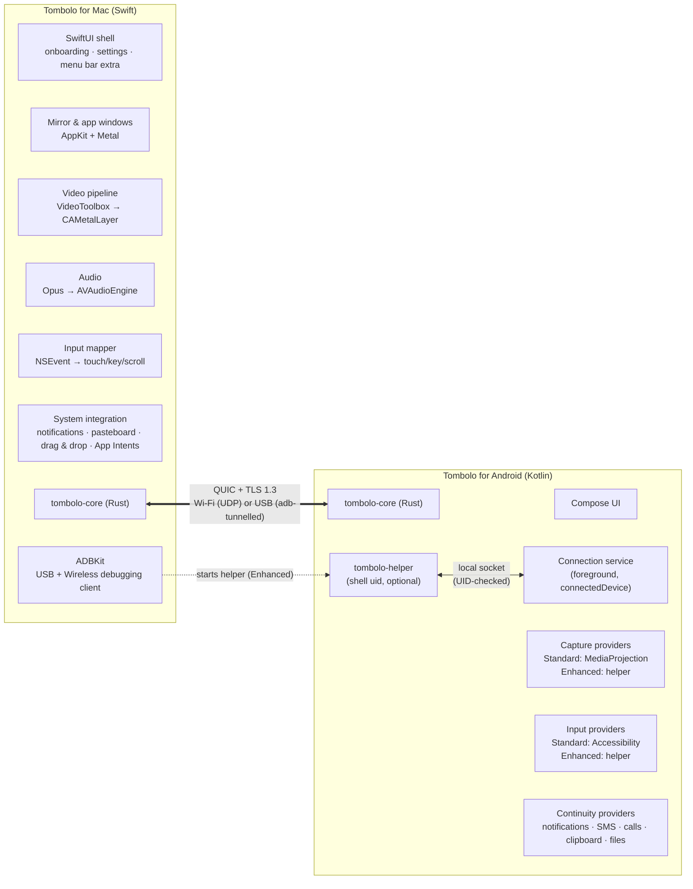

# Architecture

> Status: **proposed** — for review before any implementation starts.
> Evidence for every claim here is in [`research/`](research/); key decisions are recorded as ADRs in
> [`decisions/`](decisions/).

## 1. System overview

Tombolo is two native apps that speak one protocol:

- **Tombolo for Mac** — Swift 6 (AppKit for the video/input hot path, SwiftUI for everything else),
  macOS 14+, Apple silicon.
- **Tombolo for Android** — Kotlin + Jetpack Compose (Material 3), Android 10+ (API 29), targeting the
  latest API level.
- **tombolo-core** — a shared Rust library (transport, pairing, protocol framing, file transfer), exposed
  to Swift and Kotlin through UniFFI, so the security-critical code exists exactly once.
- **tombolo-helper** — an optional, shell-privileged helper process on the phone (a fork of the
  Apache-2.0 `scrcpy-server`) that unlocks *Enhanced mode*.



## 2. Two capability tiers, one protocol

The central design decision ([ADR-0001](decisions/0001-two-tier-capability-model.md)). Android only lets a
normal app do part of what an iPhone-Mirroring-class experience needs. Rather than pick one side, Tombolo
ships both, behind the same protocol:

| | **Standard mode** (default) | **Enhanced mode** (opt-in) |
|---|---|---|
| Who provides capture/input | The Tombolo app itself | `tombolo-helper`, running with the `shell` user's permissions |
| Setup | Install the app, pair once | Also turn on Developer options + USB or Wireless debugging, pair the Mac for debugging once |
| Screen capture | MediaProjection — Android asks **every session**; stops when the phone locks (Android 15+) | No per-session prompt; phone display can be turned **off** while mirroring |
| Control | AccessibilityService gestures; text via the accessibility input method (Android 13+) | Real-time multi-touch, key events, virtual HID keyboard/mouse |
| Phone apps as Mac windows | — (single mirror window) | One Android virtual display per Mac window |
| Audio | Playback capture tied to the projection consent | Playback capture without prompts (Android 11+) |
| Clipboard phone → Mac | Manual (tile/share/button) | Automatic |
| After a reboot | Keeps working | Helper must be restarted (by the Mac, or by the phone itself later) |
| Continuity features (notifications, SMS, calls, files) | ✅ | ✅ (same code — they never need the helper) |

The Mac never needs to know *how* a capability is implemented: the phone announces its **server mode** and a
**capability list** in the `Hello` message, and the Mac adapts the UI (for example, the app launcher opens
apps in new windows only when the `display.virtual` capability is present).

## 3. Mac app

### 3.1 Modules (Swift packages inside one Xcode project)

| Package | Responsibility | Key APIs |
|---|---|---|
| `TomboloApp` | App lifecycle, scenes, menu bar extra, onboarding, settings, device list | SwiftUI, `MenuBarExtra`, `SMAppService`, Observation |
| `MirrorKit` | Mirror window and per-app windows; window ↔ display mapping; hover toolbar | AppKit `NSWindow`/`NSView`, `CAMetalLayer` |
| `VideoPipeline` | Annex-B parsing → `CMSampleBuffer` → VideoToolbox decode → Metal presentation, display-link pacing, latest-frame-wins; fallback renderer `AVSampleBufferDisplayLayer` | VideoToolbox, Metal, `CAMetalDisplayLink` (14+) |
| `AudioPipeline` | Opus decode, small adaptive jitter buffer, playback | libopus (BSD), `AVAudioEngine` |
| `InputKit` | NSEvent → Android events: click/drag → touch, scroll phases → scroll/fling, magnify/rotate → two-finger gestures, keyboard → key events or text commits (`NSTextInputClient` for IME/non-Latin input), shortcut map | AppKit events |
| `ContinuityKit` | Mirrored notifications with reply/actions, clipboard bridge, drag-and-drop file send/receive (file promises), SMS/calls UI models | `UserNotifications`, `NSPasteboard`, `NSItemProvider` |
| `ADBKit` | ADB integration. **Until 1.0: drives a bundled `adb`** (built from AOSP sources, Apache-2.0 + NOTICE) or the user's existing install — device tracking, Wireless-debugging pairing, push, shell, loopback-only forwards; coexists with an Android Studio `adb` server on `:5037`. A native Swift/Rust ADB client is a post-1.0 item | `Process`, Network.framework |
| `ScrcpyBridge` *(Phases 1a–2)* | Client for a **pinned** `scrcpy-server` build, so mirroring works before the companion app exists | — |
| `CoreBindings` | Generated Swift bindings for `tombolo-core` | UniFFI |
| `AppShims` *(Phase 4, only if spike S13 passes)* | Generates per-Android-app `.app` shims that each own a viewer window fed with frames from the main app (IOSurface over XPC), so each phone app gets its own Dock icon, ⌘-Tab entry and Spotlight entry (Chrome PWA pattern) | locally generated bundles, XPC, IOSurface |

### 3.2 Video path (per window)

```
QUIC uni stream → media header parse → CMVideoFormatDescription (from SPS/PPS/VPS)
  → VTDecompressionSession (hardware, async, real-time) → CVPixelBuffer (IOSurface)
  → Metal texture (zero-copy) → draw on next CAMetalDisplayLink tick (newest frame wins)
```

- **No jitter buffer for video**: decode on arrival, display the newest frame on the next vsync.
- **Codec negotiation**: the Mac advertises hardware decoders (H.264 always; HEVC; AV1 on M3 and later), the
  phone picks the best encoder it has. Default H.264 until measurements say otherwise.
- **Recovery**: sequence gaps or decode errors trigger a `RequestRefresh` on the control channel.
- **Renderer toggle** from day one (Metal vs `AVSampleBufferDisplayLayer`) because macOS 26 shipped frame-pacing
  regressions that hit Moonlight.

### 3.3 Input mapping (summary)

| Mac | Android (Enhanced) | Android (Standard) |
|---|---|---|
| Click / drag | Touch down/move/up | `dispatchGesture` strokes |
| Two-finger scroll (with phases, momentum) | Scroll events / fling | Synthesised swipe |
| Pinch / rotate | Two-pointer gesture | Multi-stroke gesture |
| Keyboard — *Android-keyboard mode* | UHID keyboard → the phone's IME composes (best for shortcuts, games) | — |
| Keyboard — *Mac text-commit mode* | The Mac's input method composes (any language); committed text is sent to the focused field | Accessibility input method (13+) / IME |
| ⌘1 ⌘2 ⌘3, right-click | Home, Back, Recents | Global actions |

Coordinates are always sent **with the frame size they refer to** (scrcpy's approach), so a rotation or
resize in flight never lands a tap in the wrong place.

## 4. Android app

### 4.1 Modules (Gradle)

| Module | Responsibility |
|---|---|
| `:app` | Compose UI, onboarding, permissions-in-context, settings, Quick Settings tile, share target |
| `:service` | `ConnectionService` (foreground service, type `connectedDevice`), session state machine, discovery advertisement (`NsdManager`), CompanionDeviceManager association |
| `:capture` | `CaptureProvider` interface; `MediaProjectionCapture` (Standard) → `MediaCodec` encoder; `HelperCapture` (Enhanced) |
| `:input` | `InputProvider` interface; `AccessibilityInput` (Standard); `HelperInput` (Enhanced) |
| `:continuity` | `NotificationListenerService`, SMS (`Telephony` provider, `SmsManager`), calls (`TelecomManager`), clipboard, files (`MediaStore`, SAF), app list + icons |
| `:helper` | `tombolo-helper` — forked from `scrcpy-server` (Apache-2.0), built into the APK as a dex payload; talks to `:service` over an abstract-namespace local socket and only accepts the Tombolo app's UID |
| `:core-bindings` | Generated Kotlin bindings for `tombolo-core` |

**Build flavours** ([ADR-0006](decisions/0006-distribution.md)): `foss` (F-Droid / GitHub — full feature
set) and `play` (adjusted to Google Play policy: e.g. SAF instead of "All files access").

### 4.2 How Enhanced mode is started

1. **From the Mac (Phase 1+)** — the Mac's `ADBKit` connects over USB or Wireless debugging, pushes the helper
   payload, and starts it, as scrcpy does.
2. **From the phone itself (later)** — the app starts the helper through Wireless debugging without the Mac,
   the approach Shizuku documents for Android 11+. If the user already runs Shizuku, Tombolo can use it.

From Phase 3, the helper connects **to the Tombolo app**, never directly to the network, and the app relays
media and input over the one authenticated Tombolo session — a single security boundary. Authentication on
that local link is **bidirectional**: the helper accepts only the Tombolo app's UID (peer credentials), and the
app accepts only a helper that presents the per-launch secret handed to it by whoever started it (the Mac over
the authenticated session, or the app itself) — because any shell-UID process could otherwise pose as the
helper. Relay queues are bounded (spike S12). In Phase 1 the Mac talks to the pinned scrcpy-server directly
over ADB, under ADB's trust model (see [implementation plan, Phase 1a](implementation-plan.md#phase-1a--mirror-1014-ew--release-01-developer-preview)).

### 4.3 Background behaviour

- One foreground service (`connectedDevice`) owns the link; a `mediaProjection`-typed service is added only
  during Standard-mode capture.
- CompanionDeviceManager association with the paired Mac for **background-start exemptions** only. CDM does not
  create or keep connections; actual recovery behaviour (idle, Doze, reboot, network change, force-stop) is
  defined per OEM by spike S11 and shown honestly in the UI.
- Battery-optimisation exemption requested in onboarding, with per-OEM guidance (dontkillmyapp.com).
- Android 17: request `ACCESS_LOCAL_NETWORK` in onboarding (it shares the NEARBY_DEVICES group).

## 5. tombolo-core (Rust)

| Area | Responsibility |
|---|---|
| Transport | QUIC (RFC 9000/9001) with RFC 9221 datagrams on **iroh 1.x / noq** (MIT/Apache-2.0); UDP on Wi-Fi; on USB, the same QUIC packets length-prefixed over an adb-forwarded TCP socket ([ADR-0003](decisions/0003-transport.md)) |
| Pairing & identity | QR bootstrap, 6-digit PAKE fallback, exporter-bound session authentication ([ADR-0005](decisions/0005-pairing-and-identity.md)) |
| Protocol | Protobuf `Envelope` framing on the control stream, media headers on video streams, capability negotiation, versioning |
| File transfer | Chunked, resumable, BLAKE3-verified transfers on their own low-priority streams |
| Telemetry | RTT and clock-offset pings, receiver feedback, latency breakdown for the Diagnostics pane |

What stays **native**: capture, encode/decode, rendering, input, every OS integration and all UI. The core is
deliberately "networking + crypto + protocol" only.

**One owner for security.** Authentication and framing live in the core on every path. If spike S4 rejects QUIC
for a path, that path uses **TLS 1.3 over TCP, one connection per channel, implemented with rustls inside the
core** (not the platforms' TLS stacks), with every extra connection bound to the session by an exporter-derived
token. On USB, S4 decides between QUIC carried over one adb TCP stream and framed channels over several adb
forwards.

**No public infrastructure.** iroh's default public relays and DNS-based address lookup are **disabled**;
Tombolo works with outbound Internet blocked (tested in CI). A self-hosted relay is a later, opt-in feature.

## 6. Protocol (summary)

Full draft: [`protocol.md`](protocol.md).

| Channel | Transport primitive | Priority | Contents |
|---|---|---|---|
| `control` | 1 bidirectional stream, opened first | highest | `Hello`/capabilities, session auth, window open/resize/close, **input events**, refresh requests, receiver feedback, clipboard, notifications, SMS, calls, app list |
| `video.N` | 1 unidirectional stream per window / virtual display | focused > visible > hidden | 24-byte media header + Annex-B H.264/H.265 (AV1 optional) |
| `audio` | QUIC datagrams | high | Opus, 10–20 ms per packet |
| `clock` | QUIC datagrams | high | RTT + clock offset every 50–100 ms during sessions |
| `file.N` | 1 bidirectional stream per transfer | lowest, rate-capped | offer/accept on `control`, chunks + hashes here |
| `bulk` | unidirectional streams | low | app icons, thumbnails, logs |

Message encoding: Protobuf (Wire on Android, swift-protobuf on Mac, prost in the core), ALPN `tombolo/1`,
capability strings for everything optional. The **phone is always the media sender**; the Mac is always the
controller.

## 7. Discovery and connection

1. **Wi-Fi:** the phone advertises DNS-SD `_tombolo._udp` while its service runs. The service instance name is
   random and the TXT record holds only a protocol version and a **rotating token** (HMAC with a per-pair
   discovery key derived from the pairing secret, over a 15-minute epoch). This limits long-term tracking, but
   within an epoch an observer present on two networks can link sightings of the same token, and the port and
   announcement timing leak some information. The Mac recognises its paired phones by the token.
2. **Cached addresses** from the last session are tried in parallel (happy-eyeballs).
3. **USB:** `ADBKit` watches `host:track-devices`; when a paired phone with USB debugging appears, it sets up a
   forward to the app's local socket and prefers USB over Wi-Fi.
4. **Fallbacks:** QR (carries the Mac's addresses) and manual IP for networks where multicast is filtered.
   Networks with true client isolation block device-to-device traffic entirely — the answer there is USB or the
   phone's hotspot, not a protocol trick.
5. **Later:** BLE presence token for "phone is nearby" (never trusted for authentication); remote access via a
   **self-hosted** relay (iroh-relay), off by default.

Discovery is only a hint; identity is always proven by keys in the handshake.

## 8. Security model

Tombolo grants a computer **full remote control of a phone**. The security bar is set accordingly
([ADR-0005](decisions/0005-pairing-and-identity.md); threat model in
[`research/04`](research/04-transport-and-security.md#54-threat-model)).

- **Pairing**: the Mac shows a QR containing its endpoint ID, addresses, the SHA-256 of its P-256 identity key
  and a **256-bit one-time secret** (single use, 2–5 min TTL). The phone proves it saw the QR with an HMAC bound
  to the TLS exporter; both sides sign the transcript with their identity keys. No trust-on-first-use, no
  short-code comparison (the pattern behind KDE Connect's 2025 critical CVE). Fallback: a 6-digit code
  through a PAKE bound to the TLS exporter (the design Android's own Wireless debugging uses), max 3 tries.
- **Keys**: device identity keys are **P-256 in the Secure Enclave (Mac) and StrongBox/TEE (Android)**,
  non-exportable. The Mac key can require Touch ID, so "ask every time before control" is enforced by hardware.
- **Every session**: pinned keys only (unknown keys are rejected silently), exporter-bound signatures, per-session
  nonce, **0-RTT disabled** for control.
- **Scopes are phone-authoritative**: the phone owner grants them on the phone at pairing (split by direction:
  view vs control, read vs reply/send, receive vs send files), the phone enforces them on every command and
  subscription, and either side can revoke. Touch ID on the Mac authenticates the *Mac* user; it never grants
  access to phone data.
- **Fail closed, enforced on the phone**: a phone-side lease that the Mac must keep renewing, plus an
  independent cleanup process, means link loss, a crashed or sleeping Mac, local use of the phone, helper/app
  death and revocation all stop capture, release injected input and restore the phone's display — without
  needing any message from the Mac (spike S7; required before any input-injecting release). Ending the session
  on local use of the phone is mandatory, not optional.
- **Reviewed before built**: the full pairing/session state machine is specified with test vectors and
  externally reviewed in Phase 0, before implementation.
- **Visibility**: from 0.2 (when the phone app exists), whenever the Mac can see or control the phone, the phone
  shows a status chip, a Quick Settings tile and an ongoing notification with **Stop**, and a session log records
  which Mac connected and when. In 0.1 the indicator is Android's own debugging notification.
- **Local attackers on the phone**: the helper accepts only the Tombolo app's UID; the app's adb-reachable
  socket still requires the full cryptographic handshake (other apps can reach abstract sockets).
- **Privacy defaults**: finance/health apps excluded from notification forwarding; one-time-code redaction
  respected unless the user opts in; clips marked sensitive aren't synced; frames are never written to disk.
- **No plaintext mode** for Tombolo channels, not even over USB, not even for debugging.
- **Documented exception until 0.3:** in 0.1–0.2, mirroring and control run on the pinned scrcpy-server over
  ADB, under ADB's own trust model (debugging authorisation; Wireless-debugging TLS; plaintext inside the ADB
  transport; loopback-only forwards on the Mac). Tombolo scopes cannot constrain an ADB-authorised controller;
  the UI says so. Phase 3 moves mirroring behind the Tombolo session.

## 9. Repository layout (proposed)

```
tombolo/
├── apple/            # Xcode project + Swift packages (MirrorKit, VideoPipeline, InputKit, ADBKit, …)
├── android/          # Gradle project (:app, :service, :capture, :input, :continuity, :helper, :core-bindings)
├── core/             # Rust workspace: tombolo-core + UniFFI bindings
├── proto/            # Protobuf schemas — single source of truth for both apps
├── tools/            # latency harness, device-matrix scripts, release tooling
└── docs/             # this documentation
```

## 10. Technology choices at a glance

| Concern | Choice | Why (details in ADRs / research) |
|---|---|---|
| Mac language/UI | Swift 6, AppKit + SwiftUI | Only path to native feel and zero-copy VideoToolbox → Metal ([ADR-0002](decisions/0002-native-apps.md)) |
| Mac floor | macOS 14, arm64 only | `CAMetalDisplayLink`, Observation; macOS 27 dropped Intel |
| Android language/UI | Kotlin, Jetpack Compose, Material 3 | Platform standard |
| Android floor | API 29 (Android 10) | Playback capture, scoped storage; Enhanced audio needs 11+ |
| Shared core | Rust + UniFFI | One implementation of transport/crypto/protocol |
| Transport | QUIC (iroh 1.x / noq) on Wi-Fi; QUIC-over-adb or framed TCP channels on USB (spike S4); rustls TLS/TCP fallback | Stream isolation, datagrams, Android server role, same code for remote later ([ADR-0003](decisions/0003-transport.md)) |
| Serialization | Protobuf | Evolvable, first-class in Kotlin/Swift/Rust |
| Video | H.264 default, HEVC/AV1 negotiated | Universal hardware support |
| Audio | Opus | Low latency, PLC, BSD licence |
| Enhanced helper | Fork of `scrcpy-server` (Apache-2.0) | Proven virtual displays, UHID, audio, camera ([ADR-0004](decisions/0004-enhanced-helper.md)) |
| Mac auto-update | Sparkle 2 (EdDSA) | Works without Developer ID (with caveats) |
| Distribution | Own Homebrew tap + DMG; F-Droid + GitHub; Play later | No paid service for users; optional project costs: Android full distribution ($25 once), Apple Developer ID ($99/yr) ([ADR-0006](decisions/0006-distribution.md)) |
