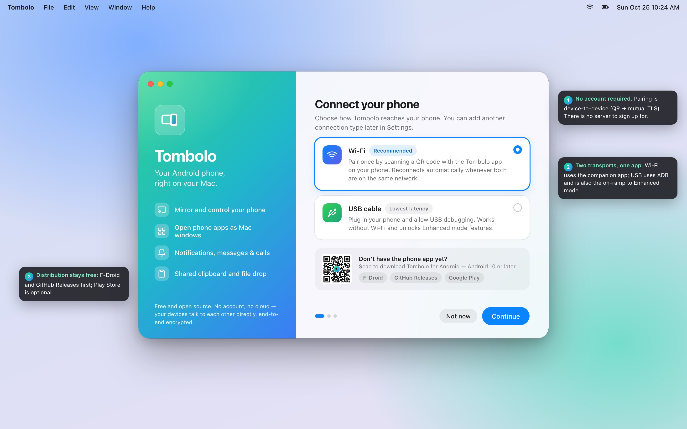
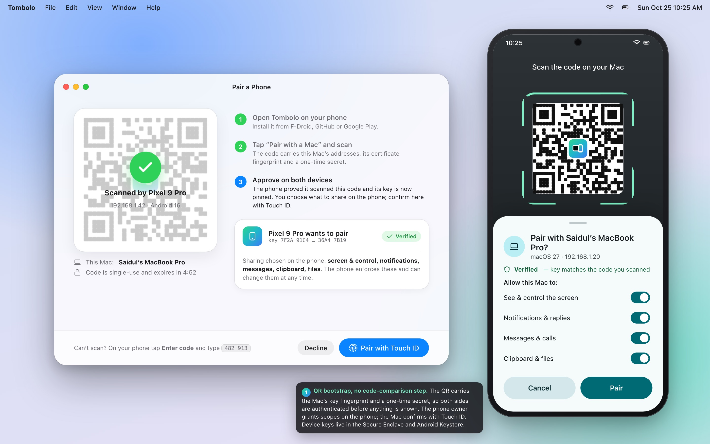
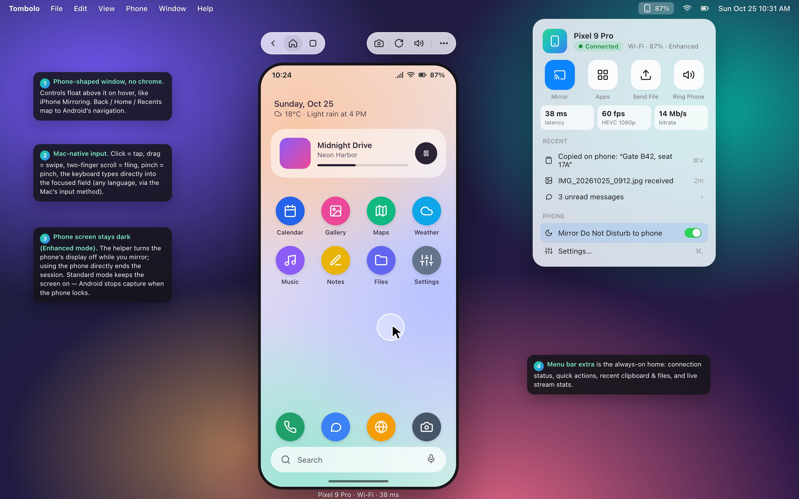
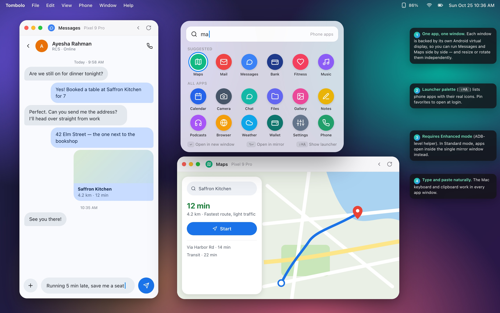
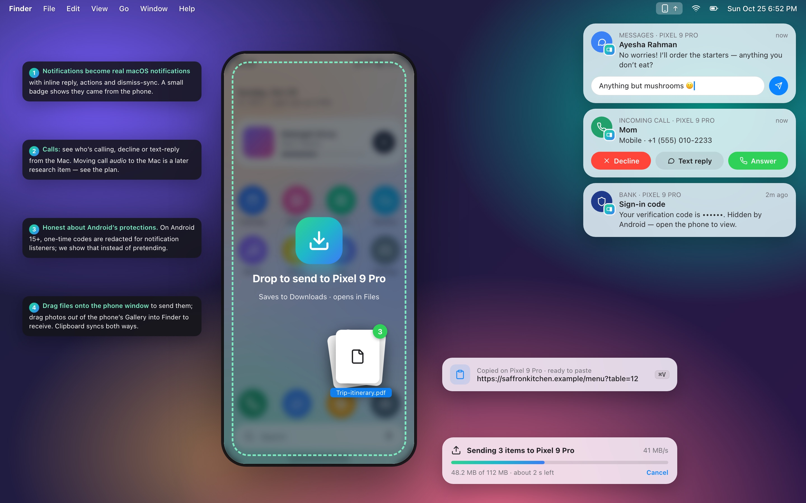
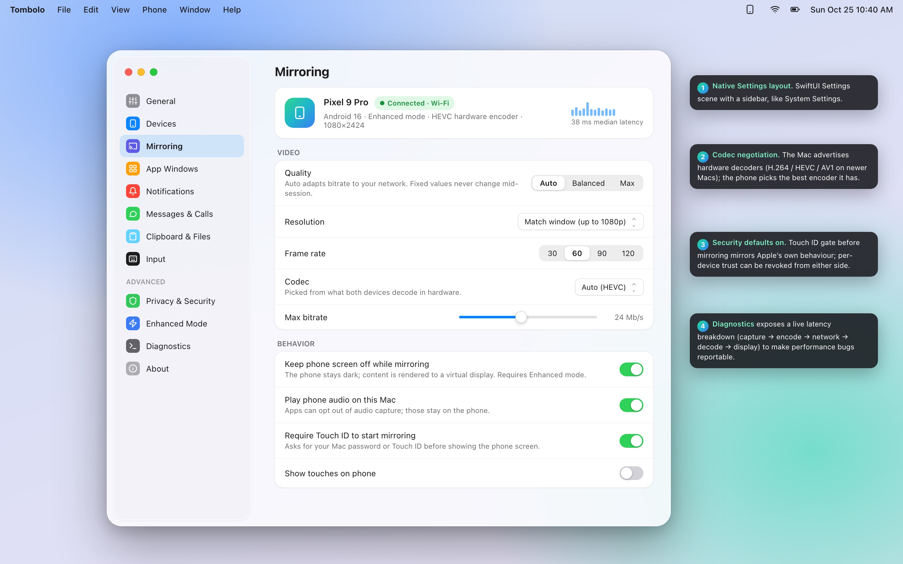
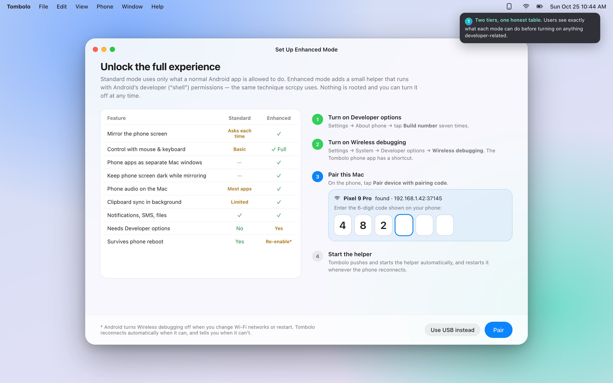
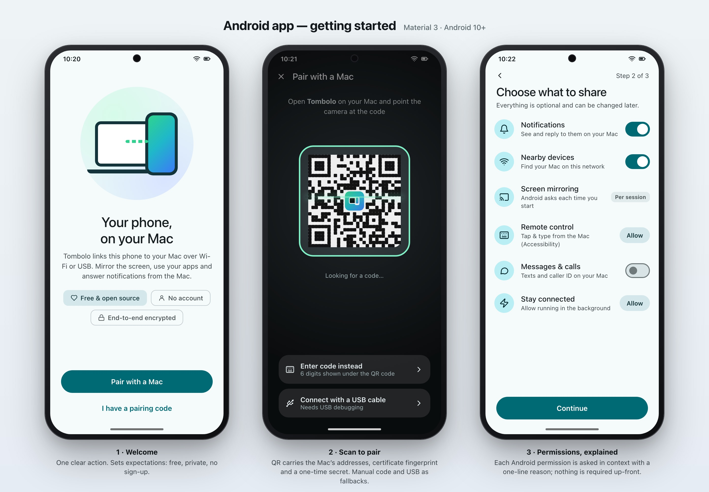
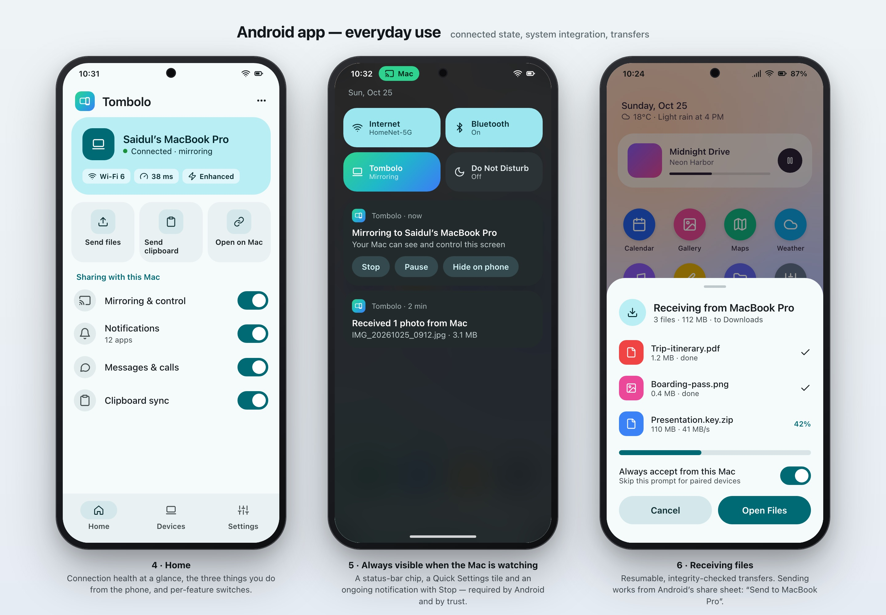
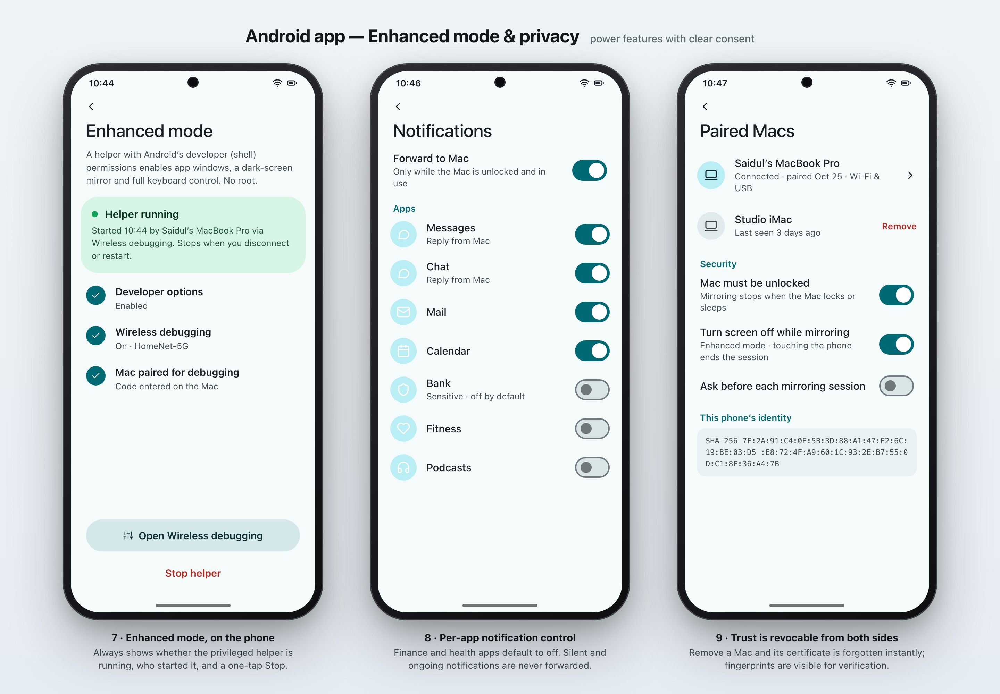

# UI concepts

> Status: **concept mockups for review** — static HTML/CSS renders, not production UI.
> Sources live in [`mockups/`](mockups/); re-render with `mockups/render.sh` (needs Google Chrome).

The design goal is simple to state: **it should feel like Apple built it for Android.** On the Mac,
Tombolo is a native SwiftUI/AppKit app that follows the current macOS design language (translucent
"Liquid Glass" materials, floating sidebars, capsule toolbars). On the phone, it is a Material 3
app that feels at home next to Google's own apps. Neither side should look like a cross-platform
compromise.

## Design principles

1. **The phone is the window.** The mirror window is just the phone's screen with rounded corners —
   no title bar, no frame. Controls appear on hover, the way iPhone Mirroring does it.
2. **Mac-native input, always.** Click is tap, drag is swipe, two-finger scroll is fling, pinch is
   pinch, and the Mac keyboard (including its input methods for non-Latin scripts) types directly
   into the focused field. Users should never need to learn a key map to do the basics.
3. **One app, one window** (Enhanced mode). Phone apps open as ordinary, resizable Mac windows that
   live in Mission Control, Stage Manager and ⌘-` cycling like any other window.
4. **Honest capability tiers.** Standard mode (plain app) and Enhanced mode (ADB-level helper) are
   shown side by side with exactly what each can do. We never hide a limitation behind a spinner.
5. **Visible when watched.** Whenever the Mac can see or control the phone, the phone shows a
   status-bar chip, a Quick Settings tile and an ongoing notification with **Stop**.
6. **Private by default.** Pairing is device-to-device. Sensitive app categories (finance, health)
   are excluded from notification forwarding by default. Touch ID gates mirroring on the Mac.
7. **No dead ends.** Every failure state (Wi-Fi isolation, Wireless debugging switched off by
   Android, permission revoked) names the cause and offers the fix.

## Brand

| Element | Choice |
|---|---|
| Name | **Tombolo** — a sandbar that joins an island to the mainland (the phone to the Mac). See [`../research/05-naming.md`](../research/05-naming.md). |
| Mark | A phone stepping out of a window: two overlapping rounded rectangles. |
| Colour | Gradient `#2FD38F → #1FB8C9 → #3B7CF6` — the green of Android meeting the blue of macOS. |
| Mac accent | System accent colour (respects the user's choice), brand gradient only for identity moments. |
| Android theme | Material 3 with a teal seed (`#006A74`), Material You dynamic colour when available. |
| Type | SF Pro on macOS; the device font (Roboto / Google Sans Flex) on Android. |

## macOS screens

### 1 · Welcome and connection choice

First launch. A single decision — Wi-Fi (recommended) or USB — plus a QR code to download the phone
app. No account creation step exists, because no account exists.

### 2 · Pairing

The Mac shows a QR code that carries its LAN addresses, the fingerprint of its identity key and a
one-time secret. When the phone scans it, the phone proves it saw the code and pins the Mac's key —
so both sides are authenticated before anything is shown. The Mac then asks the user to approve the
phone with Touch ID, while the **phone owner chooses what to share on the phone** (see & control the
screen, notifications & replies, messages & calls, clipboard & files) — the phone enforces those scopes. There is deliberately no "compare these codes" step: short-code comparison is the weak
point the research found in other tools ([ADR-0005](../decisions/0005-pairing-and-identity.md)).
Fallback for cameras-off situations: a 6-digit code typed on the phone, checked with a PAKE.

### 3 · Mirroring window and menu bar extra

The heart of the product. The phone-shaped window floats with Back / Home / Recents and
Screenshot / Rotate / Volume controls on hover. The menu bar extra is the always-available home:
connection status, quick actions (Mirror, Apps, Send File, Ring Phone), live stream statistics,
recent clipboard items and received files.

### 4 · Phone apps as Mac windows (Enhanced mode)

The launcher palette (⇧⌘A) lists the phone's apps. Each opens in its own resizable Mac window, backed
by its own Android virtual display — so Messages and Maps can sit side by side and rotate
independently. In Standard mode, apps open inside the single mirror window instead.

### 5 · Notifications, calls, clipboard and file drop

Phone notifications become native macOS notifications with inline reply, actions and dismiss-sync.
Incoming calls show caller ID with Decline / Text reply / Answer (answering happens on the phone;
call audio stays on the phone in the first releases). Files dragged onto the phone window are sent
with a progress HUD; clipboard changes flow both ways. Android 15+ redacts one-time codes for
notification listeners — the concept shows that honestly.

### 6 · Settings

A System-Settings-style window: Devices, Mirroring (quality, resolution, frame rate, codec, bitrate),
App Windows, Notifications, Messages & Calls, Clipboard & Files, Input, Privacy & Security,
Enhanced Mode and Diagnostics (live latency breakdown for bug reports).

### 7 · Enhanced mode setup

A guided wizard that explains Standard vs Enhanced in one table, then walks through Developer
options → Wireless debugging → pairing with the 6-digit code Android shows. The Mac discovers the
phone's pairing service on the LAN automatically.

## Android screens

### Getting started

Welcome → scan the Mac's QR code (manual code and USB as fallbacks) → choose what to share, with each
Android permission requested in context and explained in one line.

### Everyday use

Home shows the connected Mac with connection health, the three phone-initiated actions (Send files,
Send clipboard, Open on Mac) and per-feature switches. While the Mac is watching, the phone shows a
status chip, a Quick Settings tile and an ongoing notification with Stop / Pause. Incoming files
arrive in a bottom sheet with per-file progress.

### Enhanced mode and privacy

Enhanced mode status (is the helper running, who started it, one-tap Stop), per-app notification
forwarding with sensitive categories off by default, and the list of paired Macs with revocation
and certificate fingerprints.

## Interaction model — Mac input → Android

| Mac input | Android result | Notes |
|---|---|---|
| Click / click-drag | Tap / swipe | Single pointer touch events |
| Two-finger trackpad scroll | Scroll / fling | Sent as scroll events (Enhanced) or synthesized swipe gestures (Standard) |
| Pinch / rotate gesture | Two-finger pinch / rotate | Enhanced mode only (multi-touch injection) |
| Right-click | Back | Configurable; matches scrcpy convention |
| ⌘1 / ⌘2 / ⌘3 | Home / Back / Recents | Also in the hover toolbar |
| Typing | Text into the focused field | Enhanced: UHID keyboard or key events; Standard: IME bridge |
| ⌘C / ⌘V | Copy on phone → Mac clipboard / paste Mac clipboard on phone | Clipboard sync |
| Drag files onto window | Send to phone (Downloads) | Resumable transfer |
| Drag image out of window | Save to Mac | Phone exports the selected item |
| ⌘⇧A | App launcher palette | Enhanced mode opens new windows |
| ⌘S | Screenshot to Desktop | Full-resolution frame from the phone |

## What the mockups intentionally do not show yet

- Dark mode variants (both platforms will support them; the design tokens are already split).
- Accessibility: VoiceOver on the Mac reading the mirrored screen is a hard, open problem (see the
  research notes) — the mockups do not pretend it is solved.
- Remote (non-LAN) connections — a later phase.
- Camera-as-webcam and multi-phone UI.
