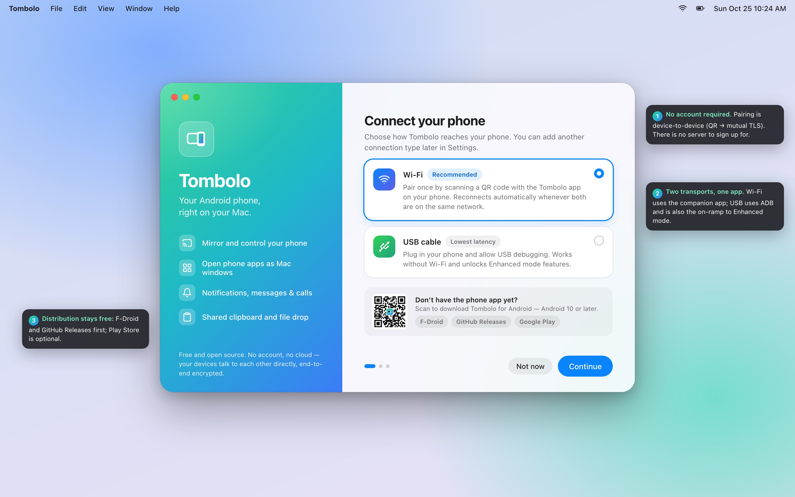
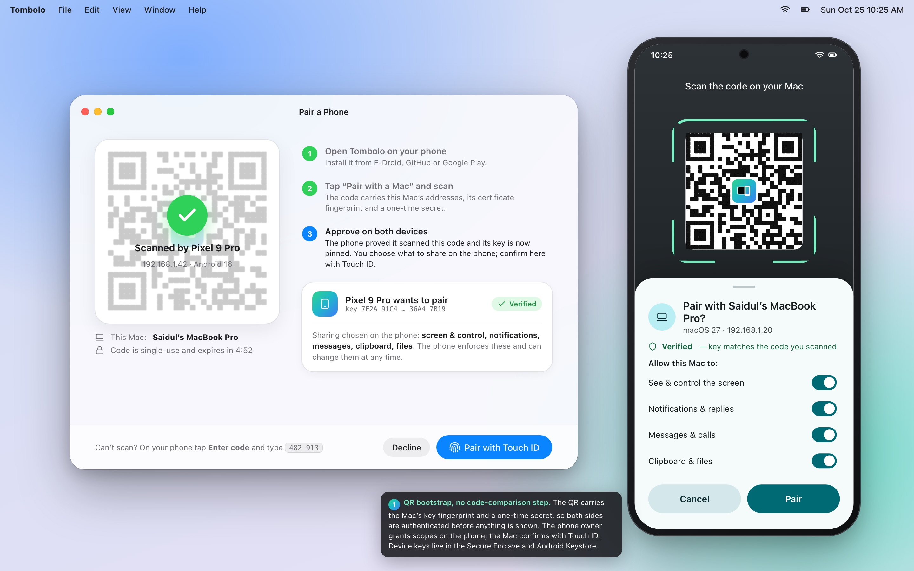
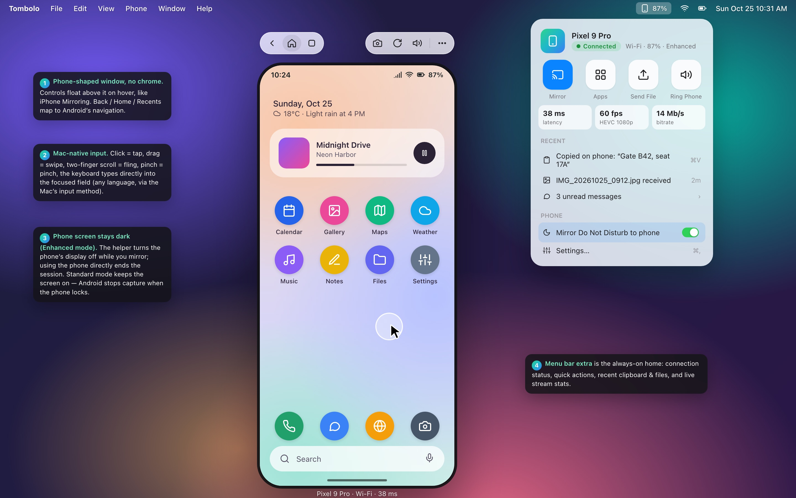
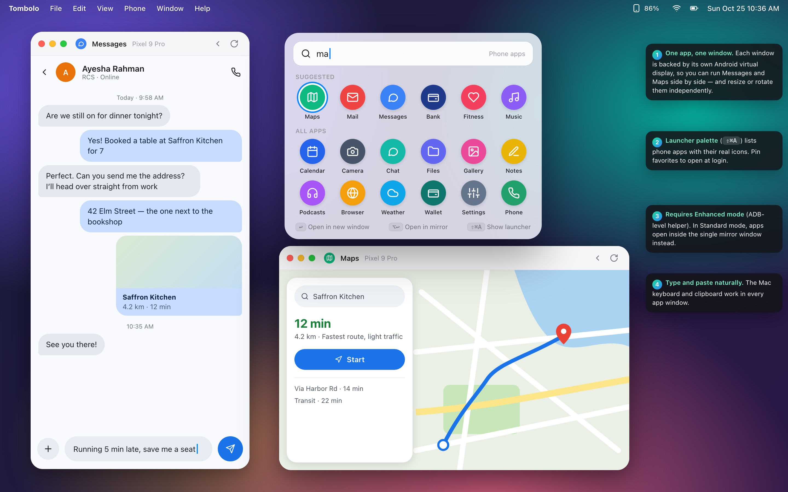
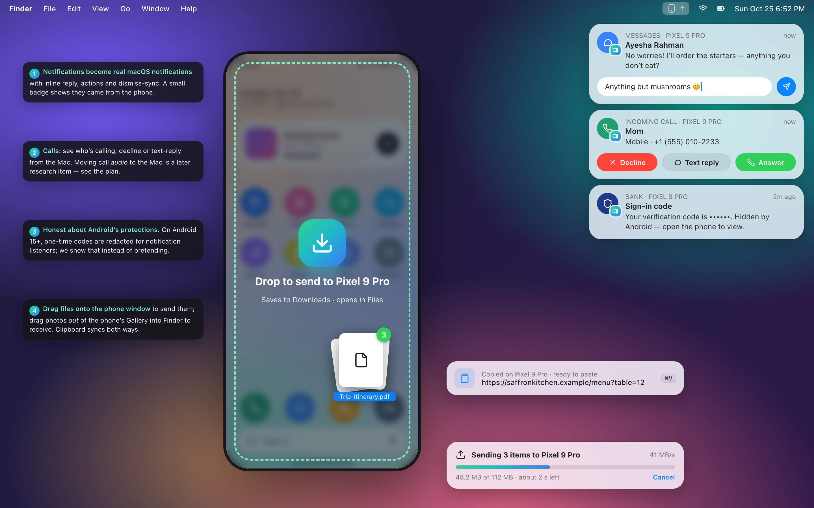
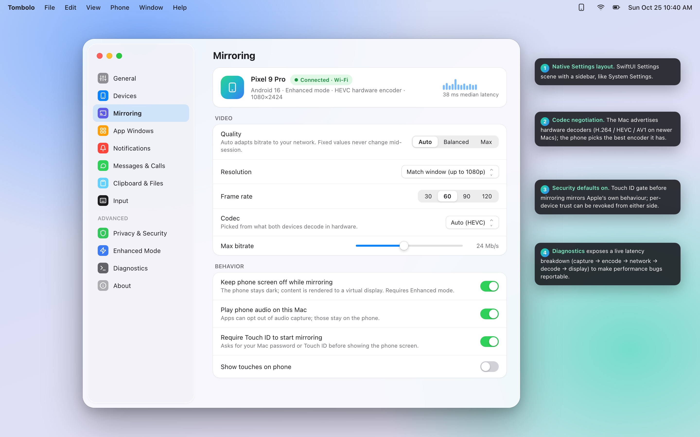
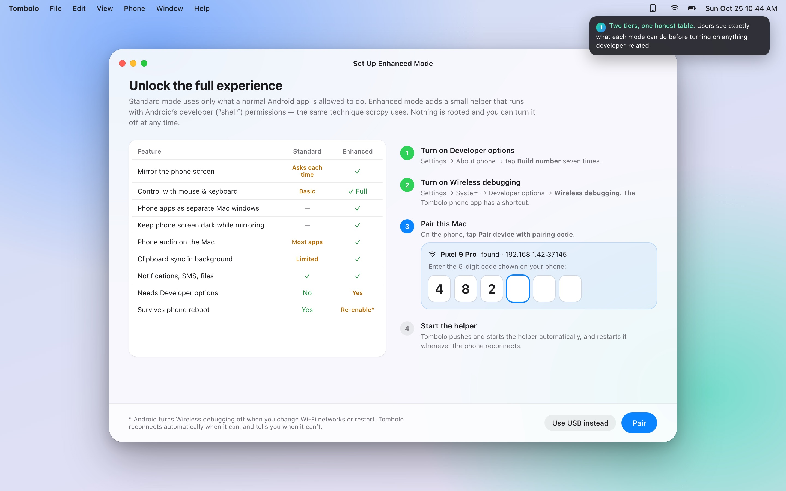
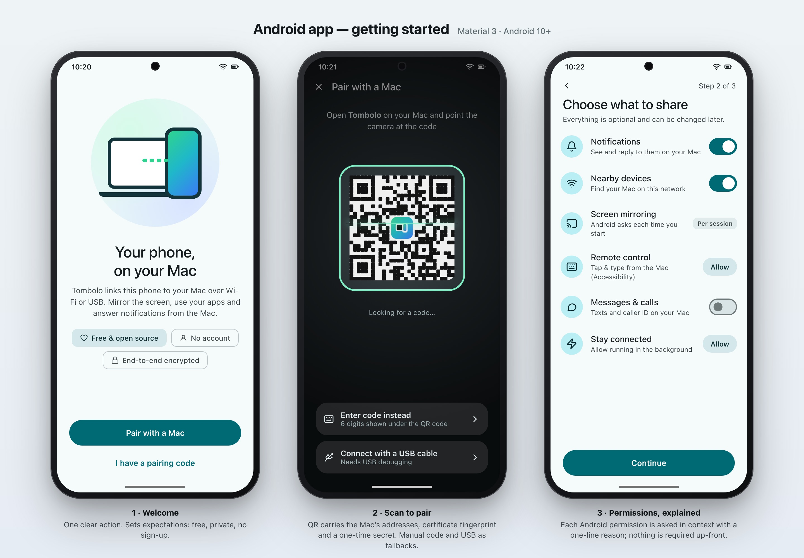
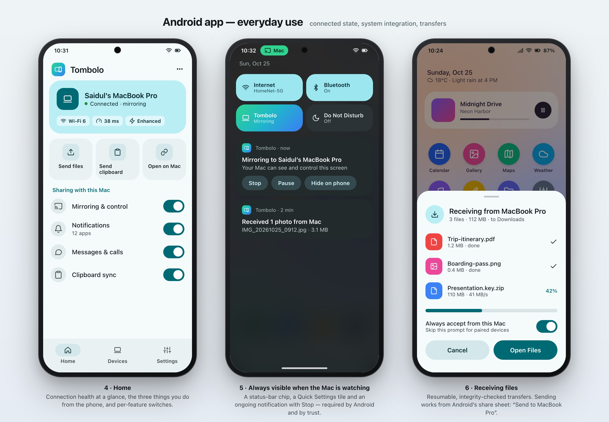
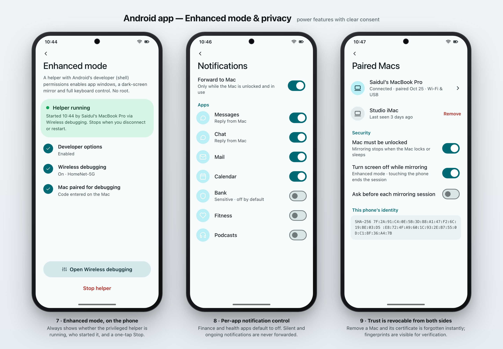

# UI concepts

> Status: **concept mockups for review** — static HTML/CSS renders, not production UI.
> Sources live in [`mockups/`](mockups/); re-render with `mockups/render.sh` (needs Google Chrome).
> The text was updated on 2026-11-02 for the approved [Standard-first re-plan](../plans/standard-first.md):
> release 0.1 needs no Developer options. **The mockups predate it** and still show USB, Enhanced mode and 0.2
> features next to 0.1 ones; the captions below say which release each feature belongs to, and
> [Mockup follow-ups](#mockup-follow-ups) lists what each mockup needs.

The design goal is simple to state: **it should feel like Apple built it for Android.** On the Mac,
Tombolo is a native SwiftUI/AppKit app that follows the current macOS design language (translucent
"Liquid Glass" materials, floating sidebars, capsule toolbars). On the phone, it is a Material 3
app that feels at home next to Google's own apps. Neither side should look like a cross-platform
compromise.

## Design principles

1. **The phone is the window.** The mirror window is just the phone's screen with rounded corners —
   no title bar, no frame. Controls appear on hover, the way iPhone Mirroring does it.
2. **Mac-native input, always.** Click is tap, drag is swipe, two-finger scroll is fling, pinch is
   pinch, and the Mac keyboard (including its input methods for non-Latin scripts) types directly
   into the focused field. Users should never need to learn a key map to do the basics. Where the
   phone can't accept input (see [view-only](#onboarding-for-01-install-two-apps)), the window says so.
3. **One app, one window** (the Advanced setting, from 0.3). Phone apps open as ordinary, resizable Mac
   windows that live in Mission Control, Stage Manager and ⌘-` cycling like any other window. In
   Standard mode they open inside the single mirror window.
4. **Honest capability tiers.** Standard mode (a plain app: the default, and all of 0.1) and Enhanced mode
   (the ADB-level helper, offered to users as the optional **Advanced** setting) are shown side by side
   with exactly what each can do — and what Advanced costs ([Advanced](#advanced-optional-setting)). We
   never hide a limitation behind a spinner; view-only is shown as what this phone allows, not as an error.
5. **Visible when watched.** Whenever the Mac can see or control the phone, the phone says so: Android's
   own projection indicator, an ongoing notification with **Stop**, and, in the app, which Mac is connected
   and whether it can view or control. Stopping is always one step away on either device
   ([Stop and revoke](#stop-and-revoke)).
6. **Private by default.** Pairing is device-to-device. Sensitive app categories (finance, health)
   are excluded from notification forwarding by default. Touch ID gates mirroring on the Mac.
7. **No dead ends.** Every failure state (phone locked, casting consent dismissed, Accessibility off or
   blocked by restricted settings, Wi-Fi client isolation, permission revoked — and, in Advanced mode,
   Wireless debugging switched off by Android) names the cause and offers the fix.

## Brand

| Element | Choice |
|---|---|
| Name | **Tombolo** — a sandbar that joins an island to the mainland (the phone to the Mac). See [`../research/05-naming.md`](../research/05-naming.md). |
| Mark | A phone stepping out of a window: two overlapping rounded rectangles. |
| Colour | Gradient `#2FD38F → #1FB8C9 → #3B7CF6` — the green of Android meeting the blue of macOS. |
| Mac accent | System accent colour (respects the user's choice), brand gradient only for identity moments. |
| Android theme | Material 3 with a teal seed (`#006A74`), Material You dynamic colour when available. |
| Type | SF Pro on macOS; the device font (Roboto / Google Sans Flex) on Android. |

## Releases the screens belong to

Per [re-plan §2](../plans/standard-first.md#2-decision-proposed):

| Release | What the UI must cover |
|---|---|
| **0.1 Mirror** | Install, QR pairing, per-Mac permissions, Accessibility, per-session consent; mirroring with phone audio; control where the device allows it (typing on Android 13+); manual clipboard Mac → phone; Stop and Revoke. Wi-Fi only |
| **0.2 Connect** | Notifications with reply, SMS, caller ID and call actions, clipboard both ways (within Android's limits), files, device status, reconnecting in the background |
| **0.3 Advanced** | The optional Advanced setting: per-app windows, mirroring with the phone's panel dark (phone awake and unlocked), no per-session prompt, UHID keyboard |
| **1.0** | Polish, app shims (if S13's open checks pass), localisation |

## Onboarding for 0.1 (install two apps)

The order the user goes through, from [re-plan §2](../plans/standard-first.md#what-the-user-does-in-01). No
Developer options, no USB or Wireless debugging, no account.

1. **Install both apps** — the Mac app (DMG or Homebrew) and the Android app (GitHub Releases or F-Droid;
   Google Play is deferred).
2. **QR pairing.** The Mac shows a QR code; the phone scans it ([Pairing](#2--pairing)).
3. **Per-Mac permissions, granted on the phone.** Separately from pairing, the phone asks what *this* Mac may
   do: **view** the screen, **control** it, write the **clipboard**. Pairing alone never grants screen
   control. The phone enforces each permission on every command and the owner can change it later.
4. **Accessibility** — only if control was granted. Android's standard warning screen; a sideloaded install
   may first need *App info → Allow restricted settings*, and onboarding walks through it. Typing needs
   Android 13+; Android 10–12 get gestures only. Where the device or its configuration blocks Accessibility
   (for example Android 17's Advanced Protection), this phone is **view-only** for the Mac, and onboarding
   says so instead of failing. Then, optional: the notification permission, so that Stop shows in the shade
   (Tombolo works without it; the other Stop routes remain); on Android 17, the local-network permission
   (what a denial means is decided by spike S8 Android). On the Mac: Local Network, and the Application
   Firewall prompt if the Mac listens for the phone.
5. **Consent each session.** The user clicks *Mirror* on the Mac. The phone shows Android's "Start recording
   or casting?" dialog — directly if Android lets the app raise it from the background, otherwise after the
   user taps Tombolo's notification on the phone (spike S17 decides which; the Mac shows "Confirm on your
   phone" meanwhile). Every session needs a fresh consent; rotation and resolution changes keep the same one.
6. **The phone stays unlocked.** Locking the phone ends the session (Android 15 QPR1+), and after unlocking
   a fresh consent is needed; the Mac says so rather than spinning. During the session Tombolo runs in the
   background on the phone, as a foreground service, while the user opens other apps through the Mac.

## Stop and revoke

| Where | Route | Effect |
|---|---|---|
| Phone | **Stop** in the ongoing notification (when notifications are allowed) | Ends the session at once; screen access for that Mac stays paused until the owner taps **Resume** on the phone |
| Phone | **Stop** in the app | Same as the notification |
| Phone | Remove a Mac in *Paired Macs*, or edit its permissions | Removing revokes the pairing at once (the Mac is told if it is connected, otherwise its next connection is refused); removing a permission takes effect on the next command |
| Mac | **Stop** (mirror window, menu bar extra) | Ends the session |
| Mac | **Revoke** (Settings → Devices) | Removes the pairing; the phone must be paired again |
| Phone | Using the phone directly while the Mac is in control | A local takeover: the Mac's input is cancelled at once and the session ends |

Every route also cancels gestures already sent and text still queued, not only future input (spike S7); if S7
fails, control is disabled everywhere. The [security design](../security/pairing-and-session.md) (lease,
revocation) defines the behaviour. Disclosure is separate from Android's consent dialog: the phone shows which
Mac is connected, whether it can view or control, clipboard writes, and how to stop and revoke.

## Advanced (optional setting)

Advanced is the user-facing name of Enhanced mode (the technical tier in the architecture documents). It
arrives in 0.3, is **off by default**, and nothing in 0.1 or 0.2 needs it.

- **Set up from the phone app**, not from the Mac: the app walks through Developer options and Wireless
  debugging, pairs with Android's on-device pairing (the Shizuku approach) and starts the helper. The Mac
  explains the tiers and points to the phone.
- **What it adds:** per-app windows (virtual displays), mirroring with the phone's panel dark while the phone
  is awake and unlocked, no per-session prompt, the UHID keyboard. It does **not** allow mirroring a locked
  phone.
- **Honest warning about ADB authority**, shown before anything is turned on and again on the Advanced status
  screen: *while Wireless debugging is on, any computer Android has authorised for debugging can fully control
  this phone, whatever Tombolo's permissions say.* Tombolo relays its own helper through the paired, encrypted
  session, but that doesn't limit other debugging connections. When Advanced is turned off, Tombolo offers to
  turn Wireless debugging off, and shows whether it is still on.

## macOS screens

### 1 · Welcome and connection choice

First launch, plus a QR code to download the phone app. No account creation step exists, because no
account exists. **0.1 has no connection choice:** Mac and phone connect over Wi-Fi after QR pairing. The
mockup's USB option needs USB debugging, so it belongs to Advanced; a USB path without debugging is a spike
before 1.0 (S18).

### 2 · Pairing

The Mac shows a QR code that carries its LAN addresses, the fingerprint of its identity key and a
one-time secret. When the phone scans it, the phone proves it saw the code and pins the Mac's key —
so both sides are authenticated before anything is shown. The Mac then asks the user to approve the
phone with Touch ID. Separately from pairing, the **phone owner chooses on the phone what this Mac may
do** — in 0.1: view the screen, control it, clipboard; notifications & replies, messages & calls and files
come with 0.2 — and the phone enforces those scopes. There is deliberately no "compare these codes" step:
short-code comparison is the weak point the research found in other tools
([ADR-0005](../decisions/0005-pairing-and-identity.md)). Fallback for cameras-off situations: a 6-digit
code typed on the phone, checked with a PAKE.

### 3 · Mirroring window and menu bar extra

The heart of the product. The phone-shaped window floats with Back / Home / Recents and
Screenshot / Rotate / Volume controls on hover. The menu bar extra is the always-available home:
connection status, quick actions, live stream statistics, recent clipboard items and received files.
In 0.1, *Mirror* waits for the consent on the phone (onboarding step 5), and **Stop** is always in the
window and the menu bar extra. *Apps* is Advanced; *Send File*, *Ring Phone* and received files are 0.2.

### 4 · Phone apps as Mac windows (Advanced, 0.3)

The launcher palette (⇧⌘A) lists the phone's apps. Each opens in its own resizable Mac window, backed
by its own Android virtual display — so Messages and Maps can sit side by side and rotate
independently. In Standard mode, apps open inside the single mirror window instead.

### 5 · Notifications, calls, clipboard and file drop (0.2)

Phone notifications become native macOS notifications with inline reply, actions and dismiss-sync.
Incoming calls show caller ID with Decline / Text reply / Answer (answering happens on the phone;
call audio stays on the phone in the first releases). Files dragged onto the phone window are sent
with a progress HUD; clipboard changes flow both ways. Android 15+ redacts one-time codes for
notification listeners — the concept shows that honestly. All of this is 0.2 Connect; 0.1 has only a
manual clipboard paste from the Mac to the phone.

### 6 · Settings

A System-Settings-style window: Devices, Mirroring (quality, resolution, frame rate, codec, bitrate),
App Windows, Notifications, Messages & Calls, Clipboard & Files, Input, Privacy & Security,
Enhanced Mode and Diagnostics (live latency breakdown for bug reports). In 0.1: Devices (with Stop and
Revoke), Mirroring, Input, Privacy & Security and Diagnostics. Notifications, Messages & Calls and files
come with 0.2; App Windows and the Enhanced Mode pane, shown to users as **Advanced**, with 0.3.

### 7 · Advanced setup

Explains Standard vs Advanced in one table, including the ADB-authority warning. The mockup still shows
the earlier Mac-driven wizard (Developer options → Wireless debugging → the 6-digit code entered on the
Mac); in the re-plan the setup happens **in the phone app** ([Advanced](#advanced-optional-setting)), and
the Mac sends the user there.

## Android screens

### Getting started

Welcome → scan the Mac's QR code (manual code as fallback) → the per-Mac permissions → Accessibility →
optional notification permission, in the [0.1 order](#onboarding-for-01-install-two-apps), with each Android
permission requested in context and explained in one line.

### Everyday use

Home shows the connected Mac with connection health, what it may do (view, control, clipboard) and
per-feature switches. While the Mac is watching, the phone shows Android's projection indicator and an
ongoing notification with **Stop**. The phone-initiated actions (Send files, Send clipboard, Open on Mac)
and the incoming-files sheet are 0.2.

### Advanced mode and privacy

Advanced status (is the helper running, one-tap Stop, the ADB-authority warning, whether Wireless debugging
is still on), per-app notification forwarding with sensitive categories off by default (0.2), and the list
of paired Macs with their permissions, revocation and certificate fingerprints.

## Interaction model — Mac input → Android

| Mac input | Android result | Notes |
|---|---|---|
| Click / click-drag | Tap / swipe | Standard: planned Accessibility gesture strokes; Advanced: touch events |
| Two-finger trackpad scroll | Scroll / fling | Sent as scroll events (Advanced) or synthesized swipe gestures (Standard) |
| Pinch / rotate gesture | Two-finger pinch / rotate | Advanced only (multi-touch injection) |
| Right-click | Back | Configurable; matches scrcpy convention |
| ⌘1 / ⌘2 / ⌘3 | Home / Back / Recents | Also in the hover toolbar |
| Typing | Text into the focused field | Standard: accessibility text commit, Android 13+ only (no typing on 10–12); Advanced: UHID keyboard or key events |
| ⌘C / ⌘V | Copy on phone → Mac clipboard / paste Mac clipboard on phone | 0.1: paste Mac → phone only; both ways from 0.2 |
| Drag files onto window | Send to phone (Downloads) | Resumable transfer (0.2) |
| Drag image out of window | Save to Mac | Phone exports the selected item (0.2) |
| ⌘⇧A | App launcher palette | Advanced opens new windows |
| ⌘S | Screenshot to Desktop | Full-resolution frame from the phone |

In a view-only session every input row is disabled, and the window says why.

## What the mockups intentionally do not show yet

- Dark mode variants (both platforms will support them; the design tokens are already split).
- Accessibility: VoiceOver on the Mac reading the mirrored screen is a hard, open problem (see the
  research notes) — the mockups do not pretend it is solved.
- Remote (non-LAN) connections — a later phase.
- Camera-as-webcam and multi-phone UI.

## Mockup follow-ups

The HTML mockups are deliberately unchanged by the 2026-11-02 update. Each needs these changes, then a
re-render with `mockups/render.sh`:

- [`mac-01-welcome.html`](mockups/mac-01-welcome.html) — remove the Wi-Fi / USB choice (0.1 is Wi-Fi only;
  the USB card needs USB debugging) and annotation 2 ("USB uses ADB and is also the on-ramp to Enhanced
  mode"); label the feature bullets by release (app windows: Advanced; notifications, messages & calls,
  file drop: 0.2); drop Google Play from the download sources (deferred; GitHub and F-Droid first).
- [`mac-02-pairing.html`](mockups/mac-02-pairing.html) — move the scope choice out of the pairing sheet into a
  separate step on the phone after pairing, offering only view, control and clipboard in 0.1 (today it lists
  notifications, messages and files and shows them on the Mac's Touch ID sheet); drop Google Play from step 1.
- [`mac-03-mirroring.html`](mockups/mac-03-mirroring.html) — add the "Confirm on your phone" waiting state
  after *Mirror*, the "phone locked — session ended" state, and **Stop** in the window and menu bar extra;
  mark *Apps* as Advanced and *Send File*, *Ring Phone* and received files as 0.2; annotation 3 ("Phone screen
  stays dark") is Advanced-only and needs "the phone stays unlocked"; the status shows "Enhanced", which
  should be Standard for 0.1.
- [`mac-04-app-windows.html`](mockups/mac-04-app-windows.html) — "Requires Enhanced mode" becomes
  "Requires the Advanced setting (0.3)".
- [`mac-05-notifications-files.html`](mockups/mac-05-notifications-files.html) — label the whole screen 0.2
  Connect; "Clipboard syncs both ways" is 0.2 (0.1 pastes Mac → phone only).
- [`mac-06-settings.html`](mockups/mac-06-settings.html) — rename the *Enhanced Mode* pane to *Advanced*; mark
  App Windows, Notifications, Messages & Calls and Clipboard & Files by release; the status line says
  "Enhanced mode" (Standard for 0.1); "Keep phone screen off while mirroring" is Advanced and needs an unlocked
  phone; add Stop and Revoke to Devices.
- [`mac-07-enhanced-mode.html`](mockups/mac-07-enhanced-mode.html) — retitle *Set Up Advanced Mode*; replace
  the Mac-driven wizard (6-digit code entered on the Mac, "Use USB instead") with "continue on your phone";
  add the ADB-authority warning; update the table: control "where the phone allows it, typing on Android
  13+" rather than "Basic", the dark panel only for an awake, unlocked phone, notifications/SMS/files as 0.2.
- [`android-01-getting-started.html`](mockups/android-01-getting-started.html) — "over Wi-Fi or USB" becomes
  Wi-Fi; remove "Connect with a USB cable — needs USB debugging"; reorder step 3 to the 0.1 order (view /
  control / clipboard for this Mac → Accessibility, with the restricted-settings walkthrough and the
  Android 10–12 no-typing note → optional notifications for Stop → Android 17 local network); move
  Notifications, Messages & calls and "Stay connected" to 0.2.
- [`android-02-everyday.html`](mockups/android-02-everyday.html) — the notification offers Stop (Pause and
  "Hide on phone" are not in the re-plan); the "Enhanced" chip becomes Standard; show view vs control and
  clipboard writes; Send files, Send clipboard, Open on Mac and the receiving sheet are 0.2.
- [`android-03-control-privacy.html`](mockups/android-03-control-privacy.html) — "Enhanced mode" becomes
  Advanced, started from the phone app (not "by Saidul's MacBook Pro via Wireless debugging"); add the
  ADB-authority warning and a "Turn off Wireless debugging" action; "Wi-Fi & USB" becomes Wi-Fi; "Turn screen
  off while mirroring" is Advanced and needs an unlocked phone; the "Ask before each mirroring session" switch
  is misleading in Standard mode, where Android always asks; add per-Mac permissions (view / control /
  clipboard) and **Resume** after Stop; the notification-forwarding panel is 0.2.
