# Implementation plan

> Status: **Phase 0 approved (2026-10-26) and in progress, partly done.** Results merged so far are listed under
> [0.C](#0c-spikes-each-produces-a-short-write-up-in-docsspikes). **The re-plan
> [*Standard mode first*](plans/standard-first.md) was approved on 2026-11-02:** the first release now needs no
> Developer options ("install two apps"). This revision applies it. Each later phase gets a task-level execution
> plan (file ownership, dependencies, acceptance criteria per task) before work starts.
>
> Revision 4 (2026-11-02) applies the re-plan. Revision 3 (2026-10-25) incorporated two rounds of independent
> review. See [§10 Review log](#10-review-log).
>
> **What is approved:** Phase 0, a bounded investigation (12–17 engineer-weeks, ≈ 6–9 weeks with two developers;
> task plan in [`plans/phase-0.md`](plans/phase-0.md)) that ends with measured spike results, a security design
> sent for external review and a **re-estimate** of Phases 1–4; and the release order below. Phases 1–4 are the
> current best plan, not a commitment.

## 0. Planning assumptions

- **Team:** 1–2 core developers plus AI-assisted contributors. Estimates are **ranges in focused
  engineer-weeks** (ew); treat the upper bound as the planning number until Phase 0 replaces guesses with
  measurements. They assume one Apple-silicon Mac and the device lab in §7.
- **Order of value — Standard first:** the first release is one a typical user can adopt: install one app on the
  phone and one on the Mac, pair them, and mirror (and control, where the device allows it) with no Developer
  options. Connectivity follows on the same session, then the optional Advanced setting (Enhanced mode: per-app
  windows, panel-off mirroring, no per-session prompt), then 1.0 polish. The maintainer chose this order on
  2026-11-01 ([§9](#9-maintainer-decisions), [re-plan](plans/standard-first.md)). It matches
  [ADR-0001](decisions/0001-two-tier-capability-model.md): Standard is the default tier, Enhanced is opt-in.
- **Free core, always:** no phase introduces a paid service, a cloud dependency or a user account.
- **Fail closed:** any session — from 0.1 onwards — must stop capture, cancel in-flight input and (in Advanced
  mode) restore the phone's display when the link drops, the phone is used locally, the Mac locks/sleeps, or
  access is revoked.
- **Evidence over intent:** acceptance numbers come from the optical latency harness (S1) and device-matrix
  runs, recorded in the repo — never from software telemetry alone. S1's software-timestamp mode supports
  development decisions; optical and device-lab acceptance stay **blocked — needs hardware** until a 240 fps
  camera and the devices exist.

## 1. Phase overview

| Phase | Name | Goal | Estimate | Release |
|---|---|---|---|---|
| 0 | Foundations, spikes & security design | Repo, CI, measured answers to risky questions, pairing/session spec sent for external review | 12–17 ew (partly done) | — |
| 1 | [**Mirror**, no developer options](#phase-1--mirror-no-developer-options-3450-ew--release-01) | Android app + Mac app; QR pairing; authenticated, encrypted transport over Wi-Fi; MediaProjection mirroring with audio; control where the device allows it (view-only otherwise); manual clipboard Mac → phone; Stop and revoke on the phone | 34–50 ew | 0.1 |
| 2 | [**Connect**](#phase-2--connect-1420-ew--release-02) | Notifications with reply, SMS, caller ID / call actions, clipboard both ways, files, device status, idle/background reconnection — on the session and pairing 0.1 built | 14–20 ew | 0.2 |
| 3 | [**Advanced mode**, optional](#phase-3--advanced-mode-optional-1727-ew--release-03) | Enhanced mode via a shell-privileged `tombolo-helper` set up from the phone app; per-app windows; panel-off mirroring of an awake, unlocked phone; no per-session prompt; UHID keyboard | 17–27 ew | 0.3 |
| 4 | [**1.0**](#phase-4--10-812-ew) | Hardening, external review of the implementation, fuzzing, distribution polish, app shims (if S13's open checks pass), localisation | 8–12 ew | 1.0 |
| 5 | [Beyond 1.0](#phase-5--beyond-10-unordered-backlog) | Webcam, remote access, call audio research, interop, multi-device | ongoing | 1.x |

**Total to 1.0: ≈ 85–126 engineer-weeks** (midpoint ≈ 105). At ≈ 4 focused engineer-weeks per developer-month
that is roughly **21–32 months for one developer** (85 ÷ 4 to 126 ÷ 4), or **11–16 months for two** with the
tracks rebalanced (42.5–63 weeks each; per-track breakdown in §2).

**First usable release (0.1):** Phase 0 + Phase 1 ≈ **46–67 ew from project start** (Phase 0 is partly done) —
very roughly 6–9 months with two developers — plus however long the external security review takes.

The total is larger than the previous plan's 74–106 ew: the first release has no ADB shortcut, and the previous
plan under-counted session lifecycle and the spikes that now move to Phase 3 ([re-plan
§5](plans/standard-first.md#5-estimates-provisional-budgeting-ranges-not-commitments)). §8 lists the cuts if the
schedule slips. **These numbers are re-estimated at the Phase 0 exit gate.**

---

## Phase 0 — Foundations, spikes & security design (12–17 ew)

**Goal:** turn the riskiest assumptions into measured facts, write the security design and send it for external
review, and set up the project so contributions can start.

**Status (2026-11-02):** approved 2026-10-26, in progress. Re-scoped on 2026-11-02 per
[re-plan §3](plans/standard-first.md#3-phase-0-changes): the spikes now serve the Standard-first order.

### 0.A Project setup
*Skeleton, docs CI and governance files merged (P0-01, P0-02); signing identity created (P0-10).*
- Monorepo skeleton (`apple/`, `android/`, `core/`, `proto/`, `tools/`, `docs/`) — empty modules only.
- CI on GitHub Actions: macOS runner builds Swift packages; Linux runner builds Android + Rust; prebuilt
  `tombolo-core` bindings published as CI artifacts so app-only contributors don't need Rust.
- Licence, `NOTICE` (scrcpy attribution), `CONTRIBUTING.md`, code of conduct, issue templates, `SECURITY.md`.
- Reserve the Android package name under Google's developer verification (limited distribution is free;
  full distribution needs the one-time $25 registration — a project cost, see §4).
- Create a stable self-signed code-signing identity for Mac builds (whether it preserves permission grants
  across updates is tested in S15, not assumed).

### 0.B Security design and review gate
Write `docs/security/pairing-and-session.md`: the complete pairing and session state machine — canonical
transcript encoding, roles and nonce ownership, persistence of the binding between each transport key and
identity key, atomic one-time-secret consumption and attempt limits **across connections**, concurrent pairing
attempts, key rotation, device loss and recovery, revocation propagation, phone-authoritative scopes — plus
test vectors. **Get it externally reviewed** (e.g. a volunteer cryptographer via the OSS community, or a funded
review).

*Status:* draft 0.1 and test vectors merged (P0-03); the [review request](security/review-request.md) is not yet
sent (M4).

**Review gate (maintainer decision 2026-11-02, [§9](#9-maintainer-decisions)):** pairing may be implemented now,
**behind a feature flag**; **nothing that contains it ships until the external review closes** — every finding
resolved or explicitly accepted. Rework risk is accepted. Pairing ships in 0.1, so the review gates the first
release.

### 0.C Spikes (each produces a short write-up in `docs/spikes/`)

**Gates** names the release a spike must finish before. A spike that can't finish in Phase 0 must finish before the
work that depends on it, and at the latest before that release.

| ID | Question | Pass criteria | If it fails | Gates |
|---|---|---|---|---|
| S1 | **Optical glass-to-glass latency harness** — build first | Reproducible p50/p95/p99 with stated measurement uncertainty | Required; no fallback | 0.1: end-to-end validation on S17 (optical acceptance needs a camera) |
| S2 | **Mac video pipeline**: pinned scrcpy-server → VideoToolbox → Metal, display-link paced | 1080p60 H.264; p50 ≤ 60 ms / p95 ≤ 90 ms on USB (optical) | Try `AVSampleBufferDisplayLayer` renderer | Mac half done; USB phone path **moved to Phase 3** (0.3) |
| S3 | **Concurrent virtual displays + encoders** | 1 × 1080p60 + 2 × 720p30 stable 10 min on Pixel + Samsung mid-range; thermals logged | Cap concurrent windows per device class | **Moved to Phase 3** (0.3) |
| S4 | **Transport**: (a) QUIC on Wi-Fi vs TLS/TCP-per-channel on Wi-Fi, (b) on USB: QUIC-over-one-adb-TCP vs framed TCP channels over adb; both with a concurrent 1 GB file transfer | On congested Wi-Fi, QUIC p95 frame latency ≤ TCP; on USB, chosen option adds ≤ 5 ms p95 | Wi-Fi: TLS/TCP per channel (rustls in core). USB: framed TCP channels | 0.1: phone runs on Wi-Fi. (b) only once a USB path is built (Phase 3 or after S18) |
| S5 | iroh/noq API surface: TLS exporter, custom transports, **default relays and DNS discovery disabled**, works with outbound Internet blocked | All available or patchable in a thin crate | quinn/noq directly | 0.1: phone rows |
| S6 | **Standard control** *(re-scoped)*: Accessibility gestures; Android 13+ accessibility text commit (Android 10–12: gestures only, no text input); the restricted-settings flow for a sideloaded APK (F-Droid's exemption is a hypothesis to test); Android 17 Advanced Protection on the emulator; control latency added on top of S17 | Tap, drag, scroll and text in 3 popular apps; outcome recorded per device/configuration: *control* or *view-only* | That configuration is **view-only** in 0.1, with an explanation; control there comes with Advanced (0.3) | 0.1 |
| S7 | **Fail-closed, in the app** *(re-scoped)*: the app owns capture and injection. Every injected action re-checks, **at execution time** (including queued callbacks), the authenticated session, granted scopes, target display, required elevation and a live lease. Events: link loss, Mac crash/sleep/lock, local takeover on the phone, Stop, revocation, Accessibility or projection revoked, service or process death | On every event, already-dispatched and continued gestures, queued text and capture are **cancelled** (not just future dispatches refused) within **1 s**, without any message from the Mac; reconnect requires fresh authorisation; the watchdog is tested against a blocked main thread; the bounded shutdown is tested with independently surviving components (e.g. the Accessibility service alive while the capture service or main process is dead). The 1 s deadline stays until a separately approved change: the security draft's 1.25 s lease worst case must be brought under it, or the change approved explicitly | **Control is disabled** (view-only everywhere) — not shipped as a documented limitation | Every release that injects input (from 0.1) |
| S8 | macOS Local Network permission with self-signed builds. **Android** *(re-scoped)*: Tombolo's actual bidirectional transport on an Android 17 (API 37 target) emulator — grant, denial, existing nearby-device grants, the system NSD picker | Documented prompts and failure modes; what denial means for onboarding decided from them | Design onboarding around them | Mac done (blocked rows open); Android: 0.1 |
| S9 | **Keyboard modes**: (a) Android-keyboard mode (UHID → phone IME), (b) Mac text-commit mode (Mac IME composes, phone receives committed text) | Both work for English, a CJK input method and an RTL language in 3 apps | Ship (a) only, document limits | **Moved to Phase 3** (0.3). 0.1's text path is tested by S6 and the Phase 1 typing matrix |
| S10 | **UniFFI integration**: hardware-key signing callbacks (Secure Enclave / Keystore) into Rust, cancellation, thread ownership, sustained 60 fps media through FFI without per-frame object conversion | 30 min stable at 1080p60 with < 1 frame added latency | Move media framing out of the core | 0.1: Keystore callbacks + 30-minute soak |
| S11a | **Active-session survival**: foreground service of type `mediaProjection` (+ `connectedDevice` if needed) while the user drives other phone apps from the Mac; OEM battery management; permission loss mid-session; network change; process death | Session survives 30 min of normal use on the Motorola; each failure ends the session fail-closed with a reason shown on both sides | Document OEM settings; shorten sessions | 0.1 |
| S11b | **Idle/background survival**: idle 24 h, Doze, reboot, network change, force-stop, revoked permissions — Pixel, Samsung, Xiaomi. Candidate wake mechanism: the Mac advertises a BLE beacon (CoreBluetooth peripheral) and the phone's CDM association observes its presence to start the foreground service | Documented recovery behaviour per OEM; chosen wake mechanism; foreground-service prerequisites met | Define degraded "open the app to reconnect" UX | 0.2 |
| S12 | **Helper ↔ app relay**: bidirectional authentication (UID check one way, per-launch secret the other), bounded relay queues, latency cost | ≤ 3 ms p95 added; no unauthenticated path | Mac talks to the helper directly over ADB, under ADB's authority (needs a maintainer decision: 0.3 relays media through the session) | **Moved to Phase 3** (0.3) |
| S13 | **App-shim viewer**: one generated `.app` owning an `NSWindow`, frames via IOSurface/XPC from the main app | Works across app restarts and an update; acceptable TCC prompts | Defer shims; per-app windows stay in the main app | 1.0 only |
| S14 | **Virtual-display app compatibility**: task affinity, single-instance activities, apps refusing secondary displays, focus, dialogs, external intents, IME | Compatibility list for top 50 apps; fallback rules defined | Allow-list approach + single-display fallback | **Moved to Phase 3** (0.3) |
| S15 | **Update persistence**: do Accessibility / Local Network / login-item grants survive an update signed with the same self-signed identity? | Grants persist | Document re-grant UX; prioritise Developer ID | Done with blocked rows (needs a person) |
| S16 | **Call control path**: deprecated `TelecomManager` answer/end vs a companion `InCallService` on Android 14–17, cellular vs self-managed calls, dual-SIM | One path works on Pixel + Samsung | Ship caller ID + "answer on phone" only | 0.2 |
| S17 | **Standard capture pipeline** *(new)*: MediaProjection (whole screen and single-app selection) → MediaCodec H.264 low-latency → Tombolo transport over Wi-Fi → `MirrorCore` decode → `AVSampleBufferDisplayLayer`. Session start from the Mac (direct activity start vs notification tap); consent cancellation; rotation as a resize of the same capture; lock → stop → fresh consent; encoder capability probing and recovery; adaptive bitrate | Motorola (Android 16), 5 GHz Wi-Fi: p50 ≤ 100 ms, p95 ≤ 180 ms in software-timestamp mode (optical pending a camera); 10 min stable at the panel's nearest supported 1080p-class size, 60 fps; every listed transition handled; phone CPU/thermals recorded. **Single-app input safety:** coordinates, focus and target changes demonstrably cannot deliver input to an app the Mac cannot see — otherwise single-app sessions are view-only | Lower default resolution/bitrate; relax targets only with published evidence | 0.1 |
| S18 | **No-debugging USB path** *(new)*: Android Open Accessory vs NCM USB tethering with macOS | One works without a kernel extension | Wi-Fi / hotspot only | 1.0 |

**Results merged so far (status 2026-11-02).** Every write-up is a draft; numbers measured on a loaded Mac are
provisional, and phone-side rows are blocked until the phone queue runs.

| Spike | Merged | Still open | Write-up |
|---|---|---|---|
| S1 (Mac side) | Harness ready in software-timestamp mode; self-test and unit tests | Phone validation (end-to-end on S17); optical method (**blocked — needs a 240 fps camera**); reproduction by a second person | [s01](spikes/s01-latency-harness.md) |
| S2 (Mac half) | Pinned server → VideoToolbox decode works; **`AVSampleBufferDisplayLayer` recommended as the default presenter** — Metal on `CAMetalDisplayLink` added ≈ 24 ms on the tested macOS 27 setup (not yet a general result) | USB phone-path acceptance runs (moved to Phase 3) | [s02](spikes/s02-mac-video.md) |
| S4/S5 (Mac half) | Loopback benchmark: QUIC with Cubic provisionally on Wi-Fi; iroh with relays, DNS discovery and portmapper disabled works with outbound Internet blocked; TLS exporter and custom transports available | Phone runs on Wi-Fi (now on the critical path); transport choice provisional until they run | [s04](spikes/s04-transport.md), [s05](spikes/s05-iroh-api.md) |
| S8 Mac | When the Local Network alert appears; pending-state failure modes; the firewall alert on the first inbound connection | Denied-state rows (needs a person) | [s08](spikes/s08-macos-local-network.md) |
| S10 (Swift half) | Secure Enclave signing callback, cancellation, thread ownership, zero-copy media ring | Android Keystore callbacks and the 30-minute soak (0.1 gates); Touch ID run; quiet-Mac re-run | [s10](spikes/s10-uniffi.md) |
| S13 (open checks) | Mac-measured: shims survive host restarts and an update; no TCC prompts | Visual Dock/⌘-Tab/Spotlight checks and macOS 14 are **blocked** — not "passed" | [s13](spikes/s13-app-shim.md) |
| S15 | Designated-requirement check; Local Network and login-item status persist across a self-signed update | Accessibility persistence and launch-at-login (needs a person) | [s15](spikes/s15-update-persistence.md) |

**Phone queue** (one task at a time on the device): S17 → S11a → S6 → S7 → S4 phone runs (Wi-Fi) → S10 Keystore →
S1 end-to-end validation on S17 → S11b → S16. S8 Android runs on the Android 17 emulator in parallel.

**Exit criteria:** write-ups merged, with verdicts, for every Phase 1 gate; the security design sent for external
review (its closing gates the 0.1 release, not the start of Phase 1); ADR-0003 moved to *Accepted* with the
transport chosen for Wi-Fi (the USB choice waits for a USB path); latency harness usable by contributors; Phases
1–4 re-estimated from the measurements; a written go/no-go for Phase 1.

**Gates:**
- **Phase 1 (0.1):** S17, S11a, S6, S7, S4/S5 phone runs on Wi-Fi, S8 Android, S10 Keystore callbacks + soak, S1
  end-to-end validation on S17 — and the external review closed before anything containing pairing ships.
- **Phase 2 (0.2):** S11b, S16.
- **Phase 3 (0.3):** S3, S9, S12, S14 and S2's USB phone path — moved from Phase 0; their effort is counted in
  Phase 3, not dropped.
- **Phase 4 (1.0):** S13's open checks (shims only if they pass), S18.
- **S7 must pass before any release that injects input. If it fails, control is disabled** (view-only
  everywhere).

---

## Phase 1 — Mirror, no developer options (34–50 ew) → release 0.1

**Goal:** a user installs the Android app and the Mac app, pairs them with a QR code, and mirrors — and, where the
device allows it, controls — the phone over Wi-Fi. No Developer options, no USB/Wireless debugging, no bundled
`adb`. What the user does, step by step: [re-plan §2](plans/standard-first.md#what-the-user-does-in-01).

**Gated by:** the Phase 1 gates in [0.C](#0c-spikes-each-produces-a-short-write-up-in-docsspikes). **Ships only
after the external security review closes** ([0.B](#0b-security-design-and-review-gate)); until then pairing is
built behind a feature flag. If the review has not closed when 0.1 is otherwise ready, 0.1 waits.

**0.1 security model:** mirroring and control require a Tombolo pairing **and** separate phone-granted scopes
(`screen.view`, `screen.control`, clipboard); the phone enforces them per command and at execution time. **No ADB
path ships in 0.1 or 0.2**: all capture and input go through the phone's scope enforcement. Phone-side controls:
Android's projection indicator, the foreground-service notification with **Stop** (when notifications are
allowed), Stop in the app, and Stop and Revoke on the Mac. Disclosure is separate from OS consent: the phone shows
which Mac is connected, whether it can view or control, clipboard writes, and how to stop and revoke.

| Workstream | Deliverables | ew |
|---|---|---|
| Mac app, video, input, packaging | SwiftUI app: onboarding (QR display; the Local Network alert triggered at a moment of intent and the firewall alert expected, per S8), device list, Settings. `VideoPipeline`: VideoToolbox decode, `AVSampleBufferDisplayLayer` presenter by default (S2) with Metal as a toggle, refresh on error. `MirrorKit`: phone-shaped window, hover toolbar, rotation, screenshots, size presets. `InputKit`: the Standard column of [architecture §3.3](architecture.md#33-input-mapping-summary) — gesture strokes, swipes, global actions, Mac text-commit to the accessibility text path. Audio playback; manual clipboard send to the phone; Stop and Revoke; sleep/lock observers. Diagnostics: stats overlay (labelled *estimates*), log export. Self-signed DMG, own Homebrew tap, build-from-source script | 7–10 |
| `tombolo-core` | Transport per S4's Wi-Fi outcome (QUIC via iroh/noq with relays, DNS discovery and portmapper disabled, or TLS/TCP per channel); a bound on frames in flight and adaptive video bitrate (S4); auth and framing owned by the core; Protobuf framing; bounded framing and message limits; UniFFI bindings with a control plane and a zero-copy media plane, including media-buffer safety (S10); Local Network denial surfaced as its own error (S8) | 8–11 |
| Pairing, identity, protocol/security work | As specified in 0.B, **behind a feature flag until the review closes**: QR pairing and the spec's code (PAKE) fallback, P-256 keys persisted in Secure Enclave / Keystore, phone-authoritative scopes, revocation on both sides, session log. Moved from the old Phase 2: capability negotiation; discovery and reconnect; pre-authentication resource budgets; replay and downgrade tests; operation with outbound Internet blocked (no relays/DNS); the [protocol §8](protocol.md#8-robustness-rules) rules that apply to screen sessions; **baseline parser fuzzing** of the Envelope, media header and pairing messages, continuous from the day each parser lands | 6–9 |
| Android app shell, service, active-session lifecycle | Compose UI per mockups: QR scan; per-Mac permissions (view, control, clipboard) asked separately from pairing; Accessibility onboarding incl. *Allow restricted settings* for sideloaded installs and Advanced Protection detection; notification permission; Android 17 local-network permission (per S8). Foreground service of type `mediaProjection` (+ `connectedDevice` if S11a needs it); NSD advertisement with a per-pair rotating token; session start from the Mac (direct activity start or a notification tap, per S17); disclosure screen; Stop in the notification and the app; clipboard writes from the Mac; OEM battery guidance (S11a) | 4–6 |
| Standard capture, input and audio | MediaProjection (whole screen and single-app) → MediaCodec H.264 low latency, with encoder capability probing, recovery and adaptive bitrate; fresh consent each session, incl. cancellation; rotation and resolution changes resize the same capture; lock → stop → fresh consent. Accessibility gestures (planned strokes) and global actions; **accessibility text commit on Android 13+** (10–12: gestures only, no text input, no input-method fallback). Playback audio capture: media/game audio from the same profile, apps may opt out, never call audio. Single-app sessions pass the input-safety tests or are view-only | 5–7 |
| Fail-closed in the app | S7's rules: execution-time checks on every injected action (incl. queued callbacks); every event cancels dispatched and continued gestures, queued text and capture; a watchdog that survives a blocked main thread; bounded shutdown with independently surviving components; reconnect needs fresh authorisation; 1 s release deadline. If S7 fails, control is disabled and 0.1 is view-only | 3–5 |
| Distribution and onboarding | Android signing and developer verification (full distribution), F-Droid build, APK on GitHub Releases; Mac install docs and firewall onboarding | 1–2 |
| **Total** | 7 + 8 + 6 + 4 + 5 + 3 + 1 = 34; 10 + 11 + 9 + 6 + 7 + 5 + 2 = 50 | **34–50** |

**Not in 0.1:** a USB connection (S18 before 1.0; the phone's hotspot is the workaround for client-isolated
networks); locked-phone mirroring (in any mode — Android does not allow it securely); notifications (0.2);
per-app windows, panel-off mirroring and the UHID keyboard (0.3); a Google Play flavour (not decided).

**Acceptance criteria** ([re-plan §6](plans/standard-first.md#6-release-acceptance-for-01-restored-from-the-current-plan-adapted))
- Mirror and control (or view-only where S6 says so) on the Motorola plus, before release, a Pixel (Android
  15–17) and a Samsung (One UI 7+) — the latter two are **blocked — needs hardware** until the device lab exists.
- Latency on 5 GHz Wi-Fi: p50 ≤ 100 ms, p95 ≤ 180 ms — **optical** acceptance, published (software-timestamp
  numbers alone do not pass it).
- 30-minute sustained session: no thermally-induced drop below 50 fps; phone battery drain and Mac energy
  recorded; Mac whole-process CPU ≤ 25 % of one core at 1080p60 on an M1 (Activity Monitor units).
- Typing matrix (English, a CJK input method, an RTL language) for the shipped text path.
- Every S7 event fails closed (tested), including in-flight gesture and text cancellation.
- Clean recovery or clean failure for Wi-Fi drop, rotation, lock, permission loss, service death.
- Security tests: unknown keys rejected; replayed or concurrent pairing secrets rejected; scope checks enforced
  phone-side; pre-authentication budgets enforced; no plaintext path; works with outbound Internet blocked.
  Baseline parser fuzzers run in CI with no open crashes.
- Single-app sessions: input-safety tests pass, or single-app sessions are view-only.
- Diagnostics: stats overlay labelled *estimates*, log export.

---

## Phase 2 — Connect (14–20 ew) → release 0.2

**Gated by:** S11b, S16. Builds on the session, pairing, core and Android app that 0.1 shipped.

**0.2 security model:** unchanged from 0.1 — every channel is authenticated, encrypted and scope-checked by the
phone; no ADB path.

| Workstream | Deliverables |
|---|---|
| Notifications | Listener → Mac notifications with inline reply, actions, dismiss sync, per-app filter (sensitive categories off by default), click → open the app in the mirror; one-time-code forwarding opt-in |
| Clipboard | Both ways, within Android's limits: Mac → phone automatic; phone → Mac via a share action or a transient focused activity |
| Files | Drag-and-drop, share-sheet "Send to Mac", resumable BLAKE3-verified transfers into confined destinations; bulk rate-capped so video keeps priority (S4) |
| SMS & calls | **SMS text** read/send with dual-SIM selection; **MMS read-only**; caller ID; decline/answer for **cellular** calls via the path chosen in S16 |
| Device status | Battery, signal, ring phone, DND mirroring in the menu bar extra |
| Background reconnection | Idle/background behaviour per S11b: the chosen wake mechanism; CDM association for background-start exemptions (**not** as a connectivity mechanism); battery guidance; Quick Settings tile |

**Acceptance criteria**
- Behaviour matches the S11b recovery table on Pixel, Samsung and Xiaomi (with battery exemption granted);
  on networks where the phone's service is running, reconnect p95 ≤ 10 s.
- Notification → Mac banner p95 ≤ 1 s on LAN; side-effecting commands (replies, SMS, call actions) are never
  executed twice across retries, reconnects or crashes — a crash mid-operation surfaces as "outcome unknown"
  rather than a silent retry ([protocol §8](protocol.md#8-robustness-rules)).
- 1 GB transfer ≥ 30 MB/s on 5 GHz Wi-Fi, resumable, hash-verified, confined to the destination folder.
- Security tests extended to the new channels: notification, SMS, call, clipboard and file commands are
  scope-checked phone-side; file writes stay confined.

---

## Phase 3 — Advanced mode, optional (17–27 ew) → release 0.3

**Gated by:** S3, S9, S12, S14 and S2's USB phone path (moved from Phase 0). S7's events are re-run with the helper
as the injector and the panel off before 0.3 ships (S7 gates every release that injects input).

**Advanced-phase platform authority (stated in the setup screen and the release notes):** Advanced mode needs
Wireless debugging, and once it is on, **any** ADB-authorised controller can drive the phone, whatever Tombolo's
scopes say. Relaying the helper's media through the Tombolo session does not change that. The Advanced setup
screen says so and offers to turn debugging off when Advanced mode is off. Tombolo's own scopes still govern
everything Tombolo does.

| Workstream | Deliverables | ew |
|---|---|---|
| `tombolo-helper` + relay | Fork of `scrcpy-server`; private app ↔ helper protocol with bidirectional auth and bounded queues (S12); media and input relayed through the authenticated session; helper capture with no per-session prompt; panel-off mirroring of an awake, unlocked phone, with display power restored on every exit path | 5–7 |
| On-device setup | Wireless-debugging pairing and helper start **from the phone app** (the Shizuku approach — previously "Path C" in Phase 4), restart after reboot, optional Shizuku integration; the setup screen states the platform authority above | 2–3 |
| Per-app windows | App list via the helper, launcher palette (⇧⌘A), one virtual display per window, flex resize; S14 compatibility list in-app — apps that misbehave open in the main mirror; concurrent-window cap per device class (S3) | 4–7 |
| UHID keyboard | Android-keyboard mode (UHID → the phone's IME) next to Mac text-commit; shortcuts | 1–2 |
| Mode switching | Capability-driven Mac UI; Advanced setup wizard (mockup 7); Standard ↔ Enhanced without re-pairing; clean fall-back to Standard when the helper dies | 2–3 |
| Moved spikes | S3, S9, S12, S14, S2's USB phone path | 3–5 |
| **Total** | 5 + 2 + 4 + 1 + 2 + 3 = 17; 7 + 3 + 7 + 2 + 3 + 5 = 27 | **17–27** |

**Acceptance criteria**
- Advanced is an opt-in setting, set up from the phone; the setup screen states the ADB authority and offers to
  turn debugging off when Advanced mode is off.
- Switching Standard ↔ Enhanced needs no re-pairing; a helper death falls back to Standard cleanly.
- Helper and app reject each other's impostors (tested both directions).
- Panel-off mirroring only on an awake, unlocked phone; every S7 event releases input and restores display power
  within 1 s.
- Within the S3 cap, the S14 "works" apps open as independent resizable windows with correct focus and typing;
  refused apps fall back to the main mirror with an explanation.
- The shipped keyboard modes pass the S9 matrix.

---

## Phase 4 — 1.0 (8–12 ew)

**Gated by:** S13's open checks (for shims), S18. S18's own effort, and any USB work that follows it, are not yet in
this estimate.

| Workstream | Deliverables |
|---|---|
| Security | External review of the implemented core/pairing; fuzzing of all parsers (beyond the 0.1 baseline); Touch ID policy via Secure Enclave; idle timeout |
| Window integration | Launcher polish, pinned apps, window-state restoration, notification → app window; **app shims only if S13's open checks pass** |
| Accessibility & i18n | VoiceOver labels on Tombolo's own controls, keyboard navigation, localisation framework + first languages |
| Updates & distribution | Sparkle 2 (EdDSA), Homebrew tap, F-Droid reproducible build, GitHub Releases; Google Play flavour only if decided by then |
| Docs | User guide, troubleshooting (client isolation, OEM battery killers, Accessibility and restricted settings, Advanced setup), protocol spec v1 |

**Acceptance criteria:** `docs/release-checklist.md` (first written for 0.1) passes on the full device matrix; no
open critical/high security findings.

---

## Phase 5 — Beyond 1.0 (unordered backlog)

| Item | Notes |
|---|---|
| Phone camera as Mac webcam | CoreMediaIO camera extension → **needs a paid Apple Developer ID** |
| Remote access (outside the LAN) | iroh NAT traversal + **self-hosted** relay only; off by default; separate scope |
| Call audio on the Mac | Research spike: macOS Bluetooth hands-free role vs shell-level call-audio capture; legal review |
| MMS sending, group messaging | Carrier config, attachments, subscription handling |
| Native ADB client (Swift/Rust) | Replaces the bundled `adb` |
| Interop | LocalSend file exchange; KDE Connect protocol; Quick Share receive (NearDrop, Unlicense) |
| Multi-phone, tablets, foldables · Mac → phone audio/mic · keyboard/mouse flowing onto the phone | |

---

## 2. Resource-loaded estimate and schedule (two developers)

Every phase estimate in §1 is the sum of these per-track work packages (engineer-weeks). Phases 1 and 3 split the
re-plan's work packages ([§5 there](plans/standard-first.md#5-estimates-provisional-budgeting-ranges-not-commitments),
with Phase 1's "Standard capture, input and audio" at 5–7 per its §9.3) by owned paths; the sums are shown in the
cells.

| Phase | Dev A — Mac (`apple/**`) | Dev B — Android + core (`android/**`, `core/**`, `proto/**`) | Phase total |
|---|---|---|---|
| 0 | 6–8 (setup, S1, S2 Mac half, S4/S5, S8 Mac, S10, S13, S15, Mac side of S17) | 6–9 (security spec, S6, S7, S8 Android, S11a, S11b, S16, S17) | 6 + 6 = 12; 8 + 9 = 17 → **12–17** |
| 1 | **9–14** = Mac app, video, input, packaging 7–10 + Mac side of pairing (Secure Enclave key, QR, pairing/permission/revocation UI, session log) 2–3 + Mac install and firewall onboarding 0–1 | **25–36** = `tombolo-core` 8–11 + pairing, identity and protocol/security work 4–6 + Android app shell and lifecycle 4–6 + Standard capture, input and audio 5–7 + fail-closed 3–5 + Android signing/verification and F-Droid build 1 | 9 + 25 = 34; 14 + 36 = 50 → **34–50** |
| 2 | 5–7 (continuity UI: notifications, SMS/calls, files, clipboard, status, menu bar extra) | 9–13 (Android continuity, core file transfer, S11b reconnection) | 5 + 9 = 14; 7 + 13 = 20 → **14–20** |
| 3 | **7–12** = per-app windows and launcher 3–5 + UHID keyboard 1–2 + mode switching 2–3 + moved spikes S9 and S2's USB phone path 1–2 | **10–15** = helper fork + relay 5–7 + on-device setup 2–3 + virtual displays and compatibility list 1–2 + moved spikes S3/S12/S14 2–3 | 7 + 10 = 17; 12 + 15 = 27 → **17–27** |
| 4 | 6–9 (security fixes, updates, window polish, shims if S13, localisation) | 2–3 (F-Droid reproducible build, fuzzing) | 6 + 2 = 8; 9 + 3 = 12 → **8–12** |
| **Total** | 6 + 9 + 5 + 7 + 6 = 33; 8 + 14 + 7 + 12 + 9 = 50 → **33–50** | 6 + 25 + 9 + 10 + 2 = 52; 9 + 36 + 13 + 15 + 3 = 76 → **52–76** | 33 + 52 = 85; 50 + 76 = 126 → **85–126** |

Phase totals: 12–17 + 34–50 + 14–20 + 17–27 + 8–12 = 85–126 (12 + 34 + 14 + 17 + 8 = 85; 17 + 50 + 20 + 27 + 12
= 126).

Dev B's track is about 1.5× Dev A's, so in practice Dev A takes over part of it once the Mac work is ahead. Dev A
ran the Rust spikes (S4/S5/S10), so `tombolo-core` work in Phase 1 is the natural part to move, then core file
transfer (Phase 2) and the Android side of the helper protocol (Phase 3). Balanced, each track carries ≈ 42–63 ew.

Illustrative calendar at midpoints, rounded to whole weeks, **before** that rebalancing:

```mermaid
gantt
  dateFormat  X
  axisFormat  wk %s
  %% Each bar is "start week, end week" (mermaid reads the last number as an end, not a length).
  section Dev A — Mac
  Phase 0                          :a0, 0, 7
  1 Mirror (Mac app, pairing UI)   :a1, 7, 19
  2 Continuity UI                  :a2, 19, 25
  3 Windows, keyboard, modes       :a3, 25, 34
  4 Mac 1.0 work                   :a4, 34, 42
  section Dev B — Android + core
  Phase 0                          :b0, 0, 8
  1 Core, pairing, Android, capture :b1, 8, 38
  2 Android continuity             :b2, 38, 49
  3 Helper, relay, on-device setup :b3, 49, 62
  4 Android 1.0 work               :b4, 62, 64
```

Bar lengths: Dev A 7 + 12 + 6 + 9 + 8 = 42 (midpoints 7 + 11.5 + 6 + 9.5 + 7.5 = 41.5); Dev B 8 + 30 + 11 + 13 + 2
= 64 (midpoints 7.5 + 30.5 + 11 + 12.5 + 2.5 = 64).

Unbalanced, 0.1 waits for Dev B's Phase 1 (≈ week 38) and Dev B finishes around week 64. Rebalanced, 0.1 lands
around week 28 ((14.5 + 42) ÷ 2, ≈ 7 months) plus the review wait, and 1.0 around week 53 (105.5 ÷ 2, ≈ 13 months).
Solo, the phases run sequentially: ≈ 105 ew at midpoints.

| Track | Owns | Depends on |
|---|---|---|
| **Mac (Dev A)** | `apple/**` | `proto/`; core bindings from Phase 1 |
| **Android + core (Dev B)** | `android/**`, `core/**`, `proto/**` | S4/S5/S10/S17 outcomes; the external review closes before pairing ships |
| **Docs & tooling (shared)** | `docs/**`, `tools/**` | — |

No two parallel tasks write the same paths; `proto/` changes go through Dev B with Dev A's review.

## 3. Testing strategy

- **Unit tests** per language (Swift Testing/XCTest, JUnit/Robolectric, `cargo test`).
- **Protocol conformance**: golden transcripts and the 0.B test vectors in `proto/testdata/`, run against both
  bindings.
- **Fuzzing**: baseline fuzzers for the Envelope, media-header and pairing parsers (`cargo fuzz`) from **Phase 1**,
  in CI from the day each parser lands; 0.1 ships with no open crashes. Broader fuzzing of the implemented core in
  Phase 4.
- **Latency regression**: optical harness (S1) before every release; results in `docs/benchmarks/` with
  p50/p95/p99 and uncertainty. Software telemetry and S1's software-timestamp mode inform development but never
  pass an acceptance criterion; optical runs are **blocked — needs hardware** until a 240 fps camera exists.
- **Lifecycle tests**: every S7 event, automated where possible — including cancellation of in-flight gestures
  and queued text, a blocked main thread, and independently surviving components.
- **Device matrix** smoke tests before every release (§7). Today only the Motorola edge 50 pro (Android 16) is
  available; Pixel and Samsung runs are **blocked — needs hardware**.
- **Security tests**: from Phase 1 — unknown key, replayed/concurrent secrets, downgrade, scope bypass
  (including execution-time checks), pre-authentication budgets, single-app input safety, Internet-blocked
  operation; from Phase 3 — unauthenticated local socket, helper impostor.

## 4. Release and distribution

0.1 is the first release with a phone app, so **Android public distribution is needed for 0.1**: GitHub Releases
and F-Droid first; Google Play is deferred (Accessibility policy risk).

| Channel | From | Cost |
|---|---|---|
| GitHub Releases (Mac DMG, Android APK) | 0.1 | Free |
| Own Homebrew tap (`saidulbadhon/tap/tombolo`) | 0.1 | Free |
| Android developer verification — limited distribution (≤ 20 devices, testers) | Phase 0 | Free |
| Android developer verification — **full distribution** (public sideloading on certified devices once enforced in the user's region; global from 2027) | before 0.1 public | **$25 one-time** (project cost) |
| F-Droid | 0.1 (build; listing once F-Droid accepts it) | Free (signing interplay with verification unresolved — monitor; whether F-Droid installs avoid restricted settings is tested in S6) |
| Google Play (`play` flavour) | deferred — not decided | Covered by the same $25 developer registration |
| Apple Developer ID + notarization | when funded | $99/yr (project cost) |

Users never pay and never need an account; these optional project costs only remove installation friction.

## 5. Risks (top 12)

| Risk | Impact | Mitigation |
|---|---|---|
| Accessibility control blocked or degraded (Android tightens `AccessibilityService`; restricted settings for sideloaded apps; Play policy scrutiny) | 0.1 control becomes view-only on affected devices/configurations | S6 per device/configuration; view-only is a supported outcome, not a release-wide downgrade; onboarding walks through *Allow restricted settings*; isolated `InputProvider`; Enhanced mode (0.3) as the full-fidelity path |
| Android 17 **Advanced Protection** revokes non-tool accessibility services and restricts sideloading | No control — or no install — for users who turn it on | S6 tests it on the emulator; detect and explain in the app; GitHub/F-Droid distribution does **not** avoid it |
| External security review timing | Gates the **first** release; late findings mean rework of pairing built behind the flag | Request sent early (M4); implement behind a feature flag, ship only after the review closes (§9); rework risk accepted; 0.1 waits rather than ships unreviewed |
| Consent UX: fresh MediaProjection consent every session; starting from the Mac may need a tap on the phone; locking ends the session | Friction every session; users bounce | S17 proves the start flow (fallback: a notification tap); fewest taps; rotation and resolution changes resize the same capture; clear end-of-session message; Advanced mode removes the per-session prompt (not the lock) |
| Security flaw in a remote-control tool | Severe | Reviewed state machine before anything ships; hardware-backed keys; phone-authoritative scopes checked at execution time; fail-closed lifecycle (S7 fails ⇒ control disabled); baseline fuzzing from 0.1; external review of the implementation before 1.0 |
| Estimates still optimistic | Slipped releases; the first release is now the largest phase | Ranges, re-estimate at the Phase 0 exit gate, §8 scope cuts |
| Standard capture misses latency/thermal targets over Wi-Fi | Laggy or hot mirroring | S17; lower default resolution/bitrate; relax targets only with published evidence; optical acceptance stays open until a camera exists |
| OEM background killing | Sessions die (0.1); continuity unreliable (0.2) | S11a: fail closed with a reason, per-OEM onboarding; S11b-defined behaviour per OEM; honest UX |
| Install friction on both platforms (Gatekeeper without Developer ID; Google developer verification, global 2027) | Users bounce at install — 0.1 now needs both apps | Own tap, clear docs, fund the $99 early; $25 full-distribution registration before 0.1 public; follow F-Droid's resolution |
| Wi-Fi only: client-isolated networks, Android 17 local-network permission, Mac Local Network/firewall alerts | Pairing or sessions fail on some networks | Phone hotspot workaround; onboarding per S8 (Mac and Android); S18 USB path before 1.0 |
| Core dependencies: Rust/UniFFI complexity; iroh defaults contact public infrastructure | Contributor friction, perf; "no services" promise broken | S10 gate (Keystore + soak before 0.1); prebuilt bindings; media plane outside UniFFI records; S5: relays, DNS discovery and portmapper disabled; Internet-blocked test in CI |
| Advanced mode fragility: scrcpy upstream churn; OEM/OS updates break virtual displays | 0.3 features break | Own helper fork; S14 list, device matrix, single-window fallback; affects only the optional tier |

Full registers: [Android](research/02-android-feasibility.md#4-risk-register),
[macOS](research/03-macos-feasibility.md#risk-register),
[transport/security](research/04-transport-and-security.md#54-threat-model).

## 6. Definition of done (every task)

Code reviewed; tests for new logic; no new lint warnings; docs updated where behaviour changed; optical/
device-matrix numbers recorded where the task touches performance; accessibility labels for new UI;
fail-closed behaviour covered where the task touches sessions.

## 7. Device lab (minimum)

| Device | Why |
|---|---|
| Google Pixel (Android 17) | Reference platform, newest restrictions |
| Samsung Galaxy mid-range (One UI 7/8) | Largest market share, OEM quirks, encoder limits |
| Xiaomi/Redmi (HyperOS) | Aggressive battery killer, extra USB-debugging security switch |
| An Android 10/11 device | Minimum-version behaviour |
| A dual-SIM phone | SMS subscription selection |
| Apple-silicon Mac on macOS 14 and on macOS 27 | Floor and current |

## 8. Scope cuts, in order, if the schedule slips

1. App shims (per-app Dock icons, 1.0) → per-app windows stay inside the main app.
2. Per-app windows (Phase 3) move after 1.0 (if S3/S14 results are poor) → 0.3 ships panel-off mirroring, no
   per-session prompt and the UHID keyboard.
3. Optional Shizuku integration (Phase 3) → on-device Wireless-debugging setup only.
4. UHID keyboard (Phase 3) → Mac text-commit mode only.
5. Standard-mode **control** → 0.1 ships view-only (plus clipboard) and control follows in a point release —
   last resort, because control is most of 0.1's value.

The Google Play flavour is already deferred, so it is no longer a cut.

## 9. Maintainer decisions

| Decision | Outcome (2026-10-26) |
|---|---|
| Licence | **GPL-3.0-or-later**; protocol spec and `proto/` schemas Apache-2.0 ([ADR-0007](decisions/0007-license.md)) |
| First milestone | **Mirror first** — the phase order in this plan |
| Project costs | **Pay once there are users** — Apple Developer ID ($99/yr) and Android full distribution ($25 once); free self-signed / limited distribution until then ([ADR-0006](decisions/0006-distribution.md)) |

~~Still pending: approval to start Phase 0 (task plan: [`plans/phase-0.md`](plans/phase-0.md)).~~ Phase 0 was
approved on 2026-10-26.

**2026-11-01 and 2026-11-02** ([re-plan §9](plans/standard-first.md#9-maintainer-decisions-2026-11-02)):

| Decision | Outcome | Date |
|---|---|---|
| First release | **Two apps first** — 0.1 is the version where a user installs one app on the phone and one on the Mac and uses it, with no Developer options; developer-mode features come later as the optional Advanced setting. Supersedes "Mirror first" above | 2026-11-01 |
| Re-plan *Standard mode first* | **Approved** ([`plans/standard-first.md`](plans/standard-first.md)); revision 4 of this plan applies it | 2026-11-02 |
| Security review gate | **Build pairing behind a feature flag** now; nothing that contains it ships until the external review closes (every finding resolved or explicitly accepted). Rework risk accepted. Replaces "review before implementation" | 2026-11-02 |
| Audio in 0.1 | **Yes** — playback capture (media/game audio, same profile, apps may opt out, never call audio) | 2026-11-02 |
| Typing | **Android 13+ only** — Android 10–12 phones mirror and accept gestures but get no keyboard text input; no input-method fallback is built. "Standard capture, input and audio" drops from 6–9 to 5–7 ew, so 0.1 is 34–50 ew and the total 85–126 ew | 2026-11-02 |

## 10. Review log

**Revision 2 — independent review (Codex, read-only, no prior context), 2026-10-25.** 17 findings; changes made:

| Finding | Change |
|---|---|
| Estimates 2–3× too low; schedule internally inconsistent | Ranges per phase, resource-loaded schedule, scope-cut list; total 53–80 ew (was 33) |
| Scopes approved on the wrong device | Scopes are **phone-authoritative**, granted on the phone, checked on every command; mockup updated |
| Pairing state machine incomplete | New Phase 0.B security design gate with external review **before** implementation |
| Phone-dark security deferred | Fail-closed lifecycle is a 0.1 acceptance criterion (S7) |
| 0.1 contradicts the security model | Documented 0.1 trust model (ADB), loopback-only forwards |
| QUIC over one adb TCP stream re-introduces blocking | S4 benchmarks Wi-Fi and USB separately; framed TCP channels allowed on USB |
| Fallback would split security ownership | The Rust core owns auth/framing on every path (rustls fallback, not platform TLS) |
| UniFFI, helper relay, shims unproven | New spikes S10, S12, S13 gate the dependent phases |
| Virtual displays ≠ independent windows; IME | S14 compatibility spike; two keyboard modes (S9); app windows split into experimental 1b |
| CDM treated as connectivity | S11 background-survival spike; CDM used only for exemptions; conditional reconnect criteria |
| SMS/MMS/calls under-specified | SMS text + MMS read-only; dual-SIM; call actions via prototyped API path (deprecated `TelecomManager` vs companion `InCallService`) |
| Clipboard tile / `KEY_LOW_LATENCY` errors | Research 02 corrected (transient activity; `KEY_LOW_LATENCY` is a decoder key) |
| Distribution cost/certainty overstated | $25 full-distribution fee added; self-signed grant persistence moved to spike S15 |
| Missing limits/idempotency/file confinement | [protocol §8](protocol.md#8-robustness-rules) added |
| Discovery privacy and iroh defaults | Qualified claims; per-pair discovery keys; relays/DNS disabled and tested offline |
| Telemetry can't measure glass-to-glass | Acceptance uses optical p50/p95/p99 with uncertainty; CPU units defined |

**Revision 3 — second review round (Codex), 2026-10-25.** Verdict: *approve only a bounded Phase 0, not the
downstream schedule.* 4 resolved, 13 partially resolved, 4 remaining high issues; changes made:

| Finding | Change |
|---|---|
| 0.2 trust boundary contradictory (mirroring still via ADB) | Explicit 0.2 trust-boundary statement; "no plaintext" scoped to Tombolo channels; Phase 3 retires the ADB bridge |
| Fail-closed has no enforcement owner | S7 now requires a **phone-side lease** + independent cleanup process; S7 must pass before any input-injecting release |
| At-most-once overclaimed | Protocol §8 defines durable operation states and an explicit "unknown" outcome; "exactly once" removed |
| Schedule doesn't reconcile | Per-track work-package table that sums to the phase totals (72–103 ew, later 74–106 after the Phase 0 task breakdown); Mac Phase 3 work allocated; approval limited to Phase 0 |
| Smaller partials | Keyboard-mode fallback; BLE + CDM presence as the candidate wake mechanism; S16 call-control gate; `subscription_id` on SMS; pre-auth budgets and buffer limits; discovery-correlation wording; telemetry wording; sustained thermal/energy criterion; ADR-0006 sandbox wording |

**Still open after review (by design, resolved in Phase 0):** the security design document and its external
review do not exist yet; all latency, thermal and background-survival numbers are estimates until the spikes
run; whether QUIC is used on each path is decided by S4/S5.

**Revision 4 — re-plan *Standard mode first*, 2026-11-02.** On 2026-11-01 the maintainer decided that the first
release needs no Developer options. The re-plan ([`plans/standard-first.md`](plans/standard-first.md)) went
through two independent review rounds (Codex, both *approve with changes*; [its
§11](plans/standard-first.md#11-review-log)) and was approved on 2026-11-02 with the decisions in §9. Changes
made here:

| Section | Change |
|---|---|
| Header, §0 | Phase 0 approved and partly done; order of value is Standard first |
| §1, phases | Releases 0.1 Mirror (no developer options), 0.2 Connect, 0.3 Advanced (optional), 1.0. The old Phases 1a, 1b, 2 and 3 are replaced and their content moved; Phase 1 acceptance is re-plan §6. The 0.1 ADB trust model is removed (no ADB path in 0.1/0.2); the Advanced-phase ADB authority is stated in Phase 3 |
| Phase 0 | 0.B review gate per §9; S11 split into S11a (0.1) and S11b (0.2); S17 and S18 added; S6, S7, S8 and S10 re-scoped (S7 keeps the 1 s deadline; if it fails, control is disabled); S3, S9, S12, S14 and S2's USB phone path moved to Phase 3; results merged so far listed with their write-ups |
| §2 | Per-track table and gantt re-derived: 85–126 ew (Dev A 33–50, Dev B 52–76). Gantt bars now give start and end weeks: mermaid reads the last number as an end, so the previous chart's later bars rendered too short |
| §3, §4 | Baseline fuzzing from Phase 1; Android public distribution for 0.1 (GitHub/F-Droid first, Play deferred) |
| §5, §8 | Risks and scope cuts updated for the new order; Accessibility, Advanced Protection, review timing and consent UX are the top risks |
| §9 | 2026-11-01/02 decisions appended |
