# Implementation plan

> Status: **proposed — awaiting approval.** No application code is written until this plan is approved.
> After approval, each phase gets a task-level execution plan (file ownership, dependencies, acceptance
> criteria per task) before work starts.
>
> Revision 3 (2026-10-25) incorporates two rounds of independent review — see [§10 Review log](#10-review-log).
>
> **What approval means right now:** approve **Phase 0 only** — a bounded investigation (10–14 engineer-weeks,
> ≈ 6–7 weeks with two developers) that ends with measured spike results, a reviewed security design and a
> **re-estimate** of Phases 1–4. The later phases below are the current best plan, not a commitment.

## 0. Planning assumptions

- **Team:** 1–2 core developers plus AI-assisted contributors. Estimates are **ranges in focused
  engineer-weeks** (ew); treat the upper bound as the planning number until Phase 0 replaces guesses with
  measurements. They assume one Apple-silicon Mac and the device lab in §7.
- **Order of value:** a fast, native mirror first (hardest, most visible, and every later feature reuses its
  video/input stack), then connectivity, then the no-developer-options tier, then polish. The order is a
  recommendation; see [§9 Open decisions](#9-open-decisions-need-the-maintainers-call-before-phase-0).
- **Free core, always:** no phase introduces a paid service, a cloud dependency or a user account.
- **Fail closed:** any session — from 0.1 onwards — must stop capture, release input and restore the phone's
  display when the link drops, the phone is used locally, the Mac locks/sleeps, or access is revoked.
- **Evidence over intent:** acceptance numbers come from the optical latency harness (S1) and device-matrix
  runs, recorded in the repo — never from software telemetry alone.

## 1. Phase overview

| Phase | Name | Goal | Estimate | Release |
|---|---|---|---|---|
| 0 | Foundations, spikes & security design | Repo, CI, measured answers to risky questions, **reviewed** pairing/session spec | 10–14 ew | — |
| 1a | **Mirror** | One native mirror window: video, control, audio, clipboard — over ADB, no phone app yet | 10–14 ew | 0.1 (developer preview) |
| 1b | **App windows** (experimental) | Phone apps as separate Mac windows via virtual displays, with a compatibility list and fallback | 4–7 ew | 0.1.x |
| 2 | **Connect** | `tombolo-core`, Android app, pairing, notifications, SMS, caller ID, clipboard, files | 26–36 ew | 0.2 |
| 3 | **Standard mode** | Mirroring/control without developer options; helper moved behind the app | 12–17 ew | 0.3 |
| 4 | **1.0** | Hardening, external security review, distribution, polish, (shims if S13 passed) | 10–15 ew | 1.0 |
| 5 | Beyond 1.0 | Webcam, remote access, call audio research, interop, multi-device | ongoing | 1.x |

**Total to 1.0: ≈ 72–103 engineer-weeks** (midpoint ≈ 88) → roughly **18–26 months for one developer**, or
**11–14 months for two** (Mac track + Android/core track; per-track breakdown in §2). This is in line with the
independent reviewer's 65–100 ew estimate; the scope already trimmed (bundled `adb` instead of a native client,
SMS text only, MMS read-only, shims gated by a spike) keeps it from growing further, and §8's cuts would save
roughly another 15–20 ew. **These numbers are re-estimated at the Phase 0 exit gate.**

---

## Phase 0 — Foundations, spikes & security design (10–14 ew)

**Goal:** turn the riskiest assumptions into measured facts, freeze a reviewed security design, and set up the
project so contributions can start.

### 0.A Project setup
- Monorepo skeleton (`apple/`, `android/`, `core/`, `proto/`, `tools/`, `docs/`) — empty modules only.
- CI on GitHub Actions: macOS runner builds Swift packages; Linux runner builds Android + Rust; prebuilt
  `tombolo-core` bindings published as CI artifacts so app-only contributors don't need Rust.
- Licence, `NOTICE` (scrcpy attribution), `CONTRIBUTING.md`, code of conduct, issue templates, `SECURITY.md`.
- Reserve the Android package name under Google's developer verification (limited distribution is free;
  full distribution needs the one-time $25 registration — a project cost, see §6).
- Create a stable self-signed code-signing identity for Mac builds (whether it preserves permission grants
  across updates is tested in S15, not assumed).

### 0.B Security design gate (before any pairing/session code)
Write `docs/security/pairing-and-session.md`: the complete pairing and session state machine — canonical
transcript encoding, roles and nonce ownership, persistence of the binding between each transport key and
identity key, atomic one-time-secret consumption and attempt limits **across connections**, concurrent pairing
attempts, key rotation, device loss and recovery, revocation propagation, phone-authoritative scopes — plus
test vectors. **Get it externally reviewed** (e.g. a volunteer cryptographer via the OSS community, or a funded
review) before Phase 2 implements it.

### 0.C Spikes (each produces a short write-up in `docs/spikes/`)

| ID | Question | Pass criteria | If it fails |
|---|---|---|---|
| S1 | **Optical glass-to-glass latency harness** — build first | Reproducible p50/p95/p99 with stated measurement uncertainty | Required; no fallback |
| S2 | **Mac video pipeline**: pinned scrcpy-server → VideoToolbox → Metal, display-link paced | 1080p60 H.264; p50 ≤ 60 ms / p95 ≤ 90 ms on USB (optical) | Try `AVSampleBufferDisplayLayer` renderer |
| S3 | **Concurrent virtual displays + encoders** | 1 × 1080p60 + 2 × 720p30 stable 10 min on Pixel + Samsung mid-range; thermals logged | Cap concurrent windows per device class |
| S4 | **Transport**: (a) QUIC on Wi-Fi vs TLS/TCP-per-channel on Wi-Fi, (b) on USB: QUIC-over-one-adb-TCP vs framed TCP channels over adb; both with a concurrent 1 GB file transfer | On congested Wi-Fi, QUIC p95 frame latency ≤ TCP; on USB, chosen option adds ≤ 5 ms p95 | Wi-Fi: TLS/TCP per channel (rustls in core). USB: framed TCP channels |
| S5 | iroh/noq API surface: TLS exporter, custom transports, **default relays and DNS discovery disabled**, works with outbound Internet blocked | All available or patchable in a thin crate | quinn/noq directly |
| S6 | **Standard-mode control quality**: Accessibility gestures + accessibility input method | Tap, drag, scroll and type a sentence in 3 popular apps | Standard = view + basic tap only |
| S7 | **Fail-closed lifecycle, enforced on the phone**: a phone-side **lease** (the controller must renew every ~250 ms; expiry ⇒ stop input injection, stop privileged capture, restore display power) plus an independent cleanup process that survives helper death (scrcpy already uses one to restore display settings). Events: link loss, Mac crash/sleep/lock, local takeover, keyguard, helper/app death, revocation, Stop | Each event releases input and stops capture within 1 s **without any message from the Mac**; documented on Android 14–17 | No control release: phone-dark mode and Enhanced control stay disabled until this passes |
| S8 | macOS Local Network permission with self-signed builds; Android 17 `ACCESS_LOCAL_NETWORK` incl. adb-forwarded sockets | Documented prompts and failure modes | Design onboarding around them |
| S9 | **Keyboard modes**: (a) Android-keyboard mode (UHID → phone IME), (b) Mac text-commit mode (Mac IME composes, phone receives committed text) | Both work for English, a CJK input method and an RTL language in 3 apps | Ship (a) only, document limits |
| S10 | **UniFFI integration**: hardware-key signing callbacks (Secure Enclave / Keystore) into Rust, cancellation, thread ownership, sustained 60 fps media through FFI without per-frame object conversion | 30 min stable at 1080p60 with < 1 frame added latency | Move media framing out of the core |
| S11 | **Background survival**: idle 24 h, Doze, reboot, network change, force-stop, revoked permissions — Pixel, Samsung, Xiaomi. Candidate wake mechanism: the Mac advertises a BLE beacon (CoreBluetooth peripheral) and the phone's CDM association observes its presence to start the foreground service | Documented recovery behaviour per OEM; chosen wake mechanism; foreground-service prerequisites met | Define degraded "open the app to reconnect" UX |
| S12 | **Helper ↔ app relay**: bidirectional authentication (UID check one way, per-launch secret the other), bounded relay queues, latency cost | ≤ 3 ms p95 added; no unauthenticated path | Mac talks to helper directly over ADB (Phase 1 model) |
| S13 | **App-shim viewer**: one generated `.app` owning an `NSWindow`, frames via IOSurface/XPC from the main app | Works across app restarts and an update; acceptable TCC prompts | Defer shims; per-app windows stay in the main app |
| S14 | **Virtual-display app compatibility**: task affinity, single-instance activities, apps refusing secondary displays, focus, dialogs, external intents, IME | Compatibility list for top 50 apps; fallback rules defined | Allow-list approach + single-display fallback |
| S15 | **Update persistence**: do Accessibility / Local Network / login-item grants survive an update signed with the same self-signed identity? | Grants persist | Document re-grant UX; prioritise Developer ID |
| S16 | **Call control path**: deprecated `TelecomManager` answer/end vs a companion `InCallService` on Android 14–17, cellular vs self-managed calls, dual-SIM | One path works on Pixel + Samsung | Ship caller ID + "answer on phone" only |

**Exit criteria:** spike write-ups merged; security design reviewed; ADR-0003 status moved to *Accepted* with the
transport chosen per path; latency harness usable by contributors. S10–S15 that can't finish in Phase 0 must
finish before the phase that depends on them (S11/S16 before Phase 2, S12 before Phase 3, S13 before Phase 4,
S14 before 1b ships). **S7 must pass before any release that injects input.**

---

## Phase 1a — Mirror (10–14 ew) → release 0.1 "developer preview"

**Goal:** the best native single-window Android mirror on macOS, for users willing to enable USB/Wireless
debugging. No phone app yet: the Mac drives a **pinned `scrcpy-server`** build through a **bundled `adb`**
(built from AOSP sources with NOTICE, or the user's existing install).

| Workstream | Deliverables |
|---|---|
| Mac app shell | SwiftUI app, onboarding for USB + Wireless debugging (discovery of the phone's pairing service, 6-digit code entry via `adb pair`), device list, Settings scene |
| ADB integration | Bundled `adb` lifecycle; coexist with an Android Studio `adb` server on `:5037`; forwards bound to loopback with random socket names |
| `VideoPipeline` | VideoToolbox decode, Metal renderer with display-link pacing, renderer toggle, refresh on error |
| `MirrorKit` | Phone-shaped borderless window, hover toolbar, rotation, screenshots, size presets |
| `InputKit` | Mapping table from [architecture §3.3](architecture.md#33-input-mapping-summary); both keyboard modes from S9 (Android-keyboard mode only, with documented limits, if S9's text-commit mode fails) |
| Audio & clipboard | Opus playback (Android 11+); clipboard both directions |
| Session lifecycle | Fail-closed rules from S7 (phone-side lease + cleanup process in the pinned server's launch configuration, Mac sleep/lock observers); phone display restored on every exit path |
| Diagnostics | Stats overlay (labelled *estimates*), log export |
| Packaging | Self-signed DMG + own Homebrew tap + build-from-source script |

**0.1 trust model (documented in the release notes):** 0.1 relies on **ADB's** security — the phone's
"Allow USB debugging" authorisation and Wireless debugging's TLS pairing. The scrcpy media/control stream is
unencrypted inside the ADB transport; on the Mac it is reachable only via a loopback forward with a random
name. There is no Tombolo phone app yet, so the phone-side indicator is Android's own "USB/Wireless debugging
connected" notification, and "Stop" means revoking debugging or unplugging. Tombolo's own pairing, scopes and
encryption arrive in 0.2.

**Acceptance criteria**
- Mirrors and controls a Pixel (Android 15–17) and a Samsung (One UI 7+) over USB **and** Wireless debugging.
- Optical latency on USB: p50 ≤ 60 ms, p95 ≤ 90 ms; on 5 GHz Wi-Fi: p50 ≤ 90 ms, p95 ≤ 150 ms. Published.
- The shipped keyboard mode(s) pass the S9 matrix.
- 30-minute sustained 1080p60 session on the reference Pixel and Samsung: no thermally-induced drop below 50 fps;
  phone battery drain and Mac energy impact recorded.
- Whole-process CPU ≤ 25 % of one core averaged at 1080p60 on an M1 (Activity Monitor units), energy impact
  recorded.
- Every S7 lifecycle event fails closed (tested).
- Clean recovery from cable unplug, Wi-Fi drop, rotation, phone screen-off/on.

## Phase 1b — App windows, experimental (4–7 ew) → release 0.1.x

| Workstream | Deliverables |
|---|---|
| Per-app windows | App list via the helper, launcher palette (⇧⌘A), one virtual display per window, flex resize |
| Compatibility | S14 compatibility list in-app; apps that misbehave open in the main mirror instead |
| Limits | Concurrent-window cap per device class from S3 |

**Acceptance criteria:** within the S3 cap, the S14 "works" apps open as independent resizable windows with
correct focus and typing; refused apps fall back to the main mirror with an explanation.

---

## Phase 2 — Connect (26–36 ew) → release 0.2

**Gated by:** security design review (0.B), S5, S10, S11, S16.

**0.2 trust boundary:** all Tombolo channels (continuity, files, clipboard, pairing) are authenticated, encrypted
and scope-checked by the phone. **Mirroring and control in 0.2 still use the 0.1 ADB path**, which sits outside
Tombolo's scope model — whoever the phone has authorised for debugging can control it regardless of Tombolo
scopes. The UI says so explicitly. Phase 3 moves mirroring behind the Tombolo session.

| Workstream | Deliverables |
|---|---|
| `tombolo-core` | Transport per S4 outcome (QUIC on Wi-Fi; framed channels or QUIC over adb on USB); auth + framing owned by the core on **every** path; Protobuf framing; capability negotiation; protocol robustness rules ([protocol §8](protocol.md#8-robustness-rules)); file transfer; UniFFI bindings |
| Pairing & identity | As specified in 0.B: QR pairing, PAKE fallback, P-256 keys in Secure Enclave / Keystore, **phone-authoritative scopes** checked on every command and subscription, revocation on both sides, session log |
| Android app | Compose UI per mockups; foreground service; NSD advertisement with per-pair rotating token; CDM association (for background-start exemptions — **not** as a connectivity mechanism); battery guidance; Android 17 local-network permission; Quick Settings tile |
| Notifications | Listener → Mac notifications with inline reply, actions, dismiss sync, per-app filter (sensitive categories off by default), click → open app |
| Clipboard | Mac → phone automatic; phone → Mac via share action or a transient focused activity (Standard) or automatic (Enhanced) |
| Files | Drag-and-drop, share-sheet "Send to Mac", resumable BLAKE3-verified transfers into confined destinations |
| SMS & calls | **SMS text** read/send with dual-SIM selection; **MMS read-only**; caller ID; decline/answer for **cellular** calls via the path chosen in S16 |
| Device status | Battery, signal, ring phone, DND mirroring in the menu bar extra |

**Acceptance criteria**
- Pair a new phone in under 60 s from first launch with no developer options.
- Behaviour matches the S11 recovery table on Pixel, Samsung and Xiaomi (with battery exemption granted);
  on networks where the phone's service is running, reconnect p95 ≤ 10 s.
- Notification → Mac banner p95 ≤ 1 s on LAN; side-effecting commands (replies, SMS, call actions) are never
  executed twice across retries, reconnects or crashes — a crash mid-operation surfaces as "outcome unknown"
  rather than a silent retry ([protocol §8](protocol.md#8-robustness-rules)).
- 1 GB transfer ≥ 30 MB/s on 5 GHz Wi-Fi, resumable, hash-verified, confined to the destination folder.
- Security tests: unknown keys rejected; replayed or concurrent pairing secrets rejected; scope checks enforced
  phone-side; adb-forwarded socket refuses unauthenticated peers; no plaintext path **for Tombolo channels**;
  pre-authentication resource budgets enforced; works with outbound Internet blocked (no default relays/DNS).

---

## Phase 3 — Standard mode & unified helper (12–17 ew) → release 0.3

**Gated by:** S6, S12.

| Workstream | Deliverables |
|---|---|
| Standard capture | MediaProjection → MediaCodec (tested encoder settings, capability probing, adaptive bitrate); consent UX incl. cancellation; single-app vs whole-screen projection coordinates; stop/resume on lock |
| Standard input | Accessibility gestures, global actions, accessibility input method (13+), IME fallback (10–12) |
| Standard audio | Playback capture tied to the projection |
| `tombolo-helper` | Fork of `scrcpy-server`; private app ↔ helper protocol with bidirectional auth and bounded queues (S12); media relayed through the authenticated session |
| Mode switching (Mac, 2–3 ew) | Capability-driven Mac UI; Enhanced setup wizard (mockup 7); clean degradation when the helper dies; retire `ScrcpyBridge` |
| Policy & safety | Play-flavour accessibility disclosure; Advanced Protection detection; OTP forwarding opt-in |

**Acceptance criteria**
- With no developer options, a user can mirror and control their phone; the consent prompt is the only
  per-session step.
- Switching Standard ↔ Enhanced needs no re-pairing.
- Standard-mode optical latency on 5 GHz Wi-Fi: p50 ≤ 100 ms, p95 ≤ 180 ms.
- Helper and app reject each other's impostors (tested both directions).

---

## Phase 4 — 1.0 (10–15 ew)

| Workstream | Deliverables |
|---|---|
| Security | External review of the implemented core/pairing; fuzzing of all parsers; Touch ID policy via Secure Enclave; idle timeout |
| Window integration | Launcher polish, pinned apps, window-state restoration, notification → app window; **app shims only if S13 passed** |
| Path C | Phone restarts the helper itself after reboot (Wireless-debugging self-start); optional Shizuku integration |
| Accessibility & i18n | VoiceOver labels on Tombolo's own controls, keyboard navigation, localisation framework + first languages |
| Updates & distribution | Sparkle 2 (EdDSA), Homebrew tap, F-Droid submission (reproducible build), GitHub Releases, optional Play flavour |
| Docs | User guide, troubleshooting (client isolation, OEM battery killers, Wireless debugging), protocol spec v1 |

**Acceptance criteria:** `docs/release-checklist.md` (written in Phase 3) passes on the full device matrix; no
open critical/high security findings.

---

## Phase 5 — Beyond 1.0 (unordered backlog)

| Item | Notes |
|---|---|
| Phone camera as Mac webcam | CoreMediaIO camera extension → **needs a paid Apple Developer ID** |
| Remote access (outside the LAN) | iroh NAT traversal + **self-hosted** relay only; off by default; separate scope |
| Call audio on the Mac | Research spike: macOS Bluetooth hands-free role vs shell-level call-audio capture; legal review |
| MMS sending, group messaging | Carrier config, attachments, subscription handling |
| Native ADB client (Swift/Rust) | Replaces the bundled `adb` |
| Interop | LocalSend file exchange; KDE Connect protocol; Quick Share receive (NearDrop, Unlicense) |
| Multi-phone, tablets, foldables · Mac → phone audio/mic · keyboard/mouse flowing onto the phone | |

---

## 2. Resource-loaded estimate and schedule (two developers)

Every phase estimate in §1 is the sum of these per-track work packages (engineer-weeks):

| Phase | Dev A — Mac (`apple/**`) | Dev B — Android + core (`android/**`, `core/**`, `proto/**`) | Phase total |
|---|---|---|---|
| 0 | 5–7 (S2, S8 mac, S9, S13, S15, setup) | 5–7 (S3–S7, S10–S12, S14, S16, security spec) | 10–14 |
| 1a | 8–11 (mirror app) | 2–3 (adb bundling, device matrix, lifecycle) | 10–14 |
| 1b | 3–5 (windows, launcher) | 1–2 (compatibility list) | 4–7 |
| 2 | 8–11 (pairing + continuity UI, core integration) | 18–25 (core 8–11, Android app 10–14) | 26–36 |
| 3 | 2–3 (mode switching) | 10–14 (Standard mode, helper fork) | 12–17 |
| 4 | 6–9 (security fixes, updates, window polish, shims if S13) | 4–6 (Path C, F-Droid, fuzzing) | 10–15 |
| **Total** | **32–46** | **40–57** | **72–103** |

Dev B's track is longer, so in practice Dev A takes over parts of it (e.g. the Android-side helper protocol or
core file transfer) once the Mac work is ahead. Illustrative calendar at midpoints, before that rebalancing:

```mermaid
gantt
  dateFormat  X
  axisFormat  wk %s
  section Dev A — Mac
  Phase 0                        :a0, 0, 6
  1a Mirror (Mac)                :a1, after a0, 10
  1b App windows (Mac)           :a2, after a1, 4
  2 Pairing + continuity UI      :a3, after a2, 10
  3 Mode switching               :a4, after a3, 3
  4 Mac 1.0 work                 :a5, after a4, 7
  section Dev B — Android + core
  Phase 0                        :b0, 0, 6
  1a support                     :b1, after b0, 3
  1b compatibility               :b2, after b1, 1
  tombolo-core                   :b3, after b2, 10
  2 Android app                  :b4, after b3, 12
  3 Standard mode + helper       :b5, after b4, 12
  4 Android 1.0 work             :b6, after b5, 5
```

Unbalanced, Dev B finishes around week 49; rebalanced, both tracks land around weeks 44–48 (≈ 11 months).
Solo, the phases run sequentially: ≈ 88 ew at midpoints.

| Track | Owns | Depends on |
|---|---|---|
| **Mac (Dev A)** | `apple/**` | `proto/`; core bindings from Phase 2 |
| **Android + core (Dev B)** | `android/**`, `core/**`, `proto/**` | S4/S5/S10 outcomes; security design review |
| **Docs & tooling (shared)** | `docs/**`, `tools/**` | — |

No two parallel tasks write the same paths; `proto/` changes go through Dev B with Dev A's review.

## 3. Testing strategy

- **Unit tests** per language (Swift Testing/XCTest, JUnit/Robolectric, `cargo test`).
- **Protocol conformance**: golden transcripts and the 0.B test vectors in `proto/testdata/`, run against both
  bindings.
- **Fuzzing** of the Envelope, media-header and pairing parsers (`cargo fuzz`) from Phase 2.
- **Latency regression**: optical harness (S1) before every release; results in `docs/benchmarks/` with
  p50/p95/p99 and uncertainty. Software telemetry is shown in Diagnostics but never used for acceptance.
- **Lifecycle tests**: every S7 event, automated where possible.
- **Device matrix** smoke tests before every release (§7).
- **Security tests**: unknown key, replayed/concurrent secrets, downgrade, scope bypass, unauthenticated local
  socket, helper impostor, Internet-blocked operation.

## 4. Release and distribution

| Channel | From | Cost |
|---|---|---|
| GitHub Releases (Mac DMG, Android APK) | 0.1 / 0.2 | Free |
| Own Homebrew tap (`saidulbadhon/tap/tombolo`) | 0.1 | Free |
| Android developer verification — limited distribution (≤ 20 devices, testers) | Phase 0 | Free |
| Android developer verification — **full distribution** (public sideloading on certified devices once enforced in the user's region; global from 2027) | before 0.2 public | **$25 one-time** (project cost) |
| F-Droid | 0.2 / 1.0 | Free (signing interplay with verification unresolved — monitor) |
| Google Play (`play` flavour) | 1.0, optional | Covered by the same $25 developer registration |
| Apple Developer ID + notarization | when funded | $99/yr (project cost) |

Users never pay and never need an account; these optional project costs only remove installation friction.

## 5. Risks (top 10)

| Risk | Impact | Mitigation |
|---|---|---|
| Security flaw in a remote-control tool | Severe | Reviewed state machine before coding; hardware-backed keys; phone-authoritative scopes; fail-closed lifecycle; fuzzing; external review before 1.0 |
| Estimates still optimistic | Slipped releases | Ranges, approval limited to Phase 0, re-estimate at its exit gate, §8 scope cuts |
| Gatekeeper friction without Developer ID | Users bounce at install | Own tap, clear docs, fund the $99 early |
| Google developer verification (global 2027) | Sideload/F-Droid friction | Full-distribution registration ($25); Play flavour; follow F-Droid's resolution |
| Android tightens AccessibilityService | Standard control degrades | Enhanced mode as full-fidelity path; isolated `InputProvider` |
| OEM/OS updates break virtual displays | App windows break | S14 list, device matrix, track scrcpy, single-window fallback |
| OEM background killing | Continuity features unreliable | S11-defined behaviour per OEM; honest UX |
| scrcpy protocol churn | 0.1 bridge breaks on upgrade | Pinned server; replaced by our own helper in Phase 3 |
| Rust/UniFFI complexity | Contributor friction, perf | S10 gate; prebuilt bindings; keep media framing out of the core if needed |
| iroh defaults contact public infrastructure | Privacy/"no services" promise broken | S5: relays and DNS discovery disabled; Internet-blocked test in CI |

Full registers: [Android](research/02-android-feasibility.md#4-risk-register),
[macOS](research/03-macos-feasibility.md#risk-register),
[transport/security](research/04-transport-and-security.md#54-threat-model).

## 6. Definition of done (every task)

Code reviewed; tests for new logic; no new lint warnings; docs updated where behaviour changed; optical/
device-matrix numbers recorded where the task touches performance; accessibility labels for new UI;
fail-closed behaviour covered where the task touches sessions.

## 7. Device lab (minimum)

| Device | Why |
|---|---|
| Google Pixel (Android 17) | Reference platform, newest restrictions |
| Samsung Galaxy mid-range (One UI 7/8) | Largest market share, OEM quirks, encoder limits |
| Xiaomi/Redmi (HyperOS) | Aggressive battery killer, extra USB-debugging security switch |
| An Android 10/11 device | Minimum-version behaviour |
| A dual-SIM phone | SMS subscription selection |
| Apple-silicon Mac on macOS 14 and on macOS 27 | Floor and current |

## 8. Scope cuts, in order, if the schedule slips

1. App shims (per-app Dock icons) → per-app windows stay inside the main app.
2. Path C (phone self-starts the helper) → Mac restarts it.
3. Standard-mode **control** → Standard mode becomes view-only + continuity features.
4. Play flavour → F-Droid/GitHub only.
5. Phase 1b app windows move after 1.0 (if S3/S14 results are poor).

## 9. Open decisions (need the maintainer's call before Phase 0)

1. **Licence** — GPL-3.0-or-later vs Apache-2.0 ([ADR-0007](decisions/0007-license.md), *Proposed*).
2. **First milestone** — Mirror-first (this plan) vs Connect-first vs Standard-mode-first.
3. **Project costs** — whether/when to fund Apple Developer ID ($99/yr) and Android full distribution ($25 once).

## 10. Review log

**Revision 2 — independent review (Codex, read-only, no prior context), 2026-10-25.** 17 findings; changes made:

| Finding | Change |
|---|---|
| Estimates 2–3× too low; schedule internally inconsistent | Ranges per phase, resource-loaded schedule, scope-cut list; total 53–80 ew (was 33) |
| Scopes approved on the wrong device | Scopes are **phone-authoritative**, granted on the phone, checked on every command; mockup updated |
| Pairing state machine incomplete | New Phase 0.B security design gate with external review **before** implementation |
| Phone-dark security deferred | Fail-closed lifecycle is a 0.1 acceptance criterion (S7) |
| 0.1 contradicts the security model | Documented 0.1 trust model (ADB), loopback-only forwards |
| QUIC over one adb TCP stream re-introduces blocking | S4 benchmarks Wi-Fi and USB separately; framed TCP channels allowed on USB |
| Fallback would split security ownership | The Rust core owns auth/framing on every path (rustls fallback, not platform TLS) |
| UniFFI, helper relay, shims unproven | New spikes S10, S12, S13 gate the dependent phases |
| Virtual displays ≠ independent windows; IME | S14 compatibility spike; two keyboard modes (S9); app windows split into experimental 1b |
| CDM treated as connectivity | S11 background-survival spike; CDM used only for exemptions; conditional reconnect criteria |
| SMS/MMS/calls under-specified | SMS text + MMS read-only; dual-SIM; call actions via prototyped API path (deprecated `TelecomManager` vs companion `InCallService`) |
| Clipboard tile / `KEY_LOW_LATENCY` errors | Research 02 corrected (transient activity; `KEY_LOW_LATENCY` is a decoder key) |
| Distribution cost/certainty overstated | $25 full-distribution fee added; self-signed grant persistence moved to spike S15 |
| Missing limits/idempotency/file confinement | [protocol §8](protocol.md#8-robustness-rules) added |
| Discovery privacy and iroh defaults | Qualified claims; per-pair discovery keys; relays/DNS disabled and tested offline |
| Telemetry can't measure glass-to-glass | Acceptance uses optical p50/p95/p99 with uncertainty; CPU units defined |

**Revision 3 — second review round (Codex), 2026-10-25.** Verdict: *approve only a bounded Phase 0, not the
downstream schedule.* 4 resolved, 13 partially resolved, 4 remaining high issues; changes made:

| Finding | Change |
|---|---|
| 0.2 trust boundary contradictory (mirroring still via ADB) | Explicit 0.2 trust-boundary statement; "no plaintext" scoped to Tombolo channels; Phase 3 retires the ADB bridge |
| Fail-closed has no enforcement owner | S7 now requires a **phone-side lease** + independent cleanup process; S7 must pass before any input-injecting release |
| At-most-once overclaimed | Protocol §8 defines durable operation states and an explicit "unknown" outcome; "exactly once" removed |
| Schedule doesn't reconcile | Per-track work-package table that sums to the phase totals (72–103 ew); Mac Phase 3 work allocated; approval limited to Phase 0 |
| Smaller partials | Keyboard-mode fallback; BLE + CDM presence as the candidate wake mechanism; S16 call-control gate; `subscription_id` on SMS; pre-auth budgets and buffer limits; discovery-correlation wording; telemetry wording; sustained thermal/energy criterion; ADR-0006 sandbox wording |

**Still open after review (by design, resolved in Phase 0):** the security design document and its external
review do not exist yet; all latency, thermal and background-survival numbers are estimates until the spikes
run; whether QUIC is used on each path is decided by S4/S5.
